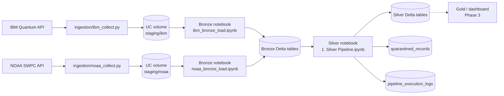

# Phase 2 Final Documentation

**Status:** Frozen / as-built
**Consolidated:** 2026-10-23
**Implementation scope:** IBM Quantum calibration data and NOAA SWPC space-weather data, from collection through Silver
**Implementation changes after freeze:** None. Phase 3 work is tracked separately.

This is the final Phase 2 documentation. It describes what is actually implemented in the collectors, workflows, notebooks, and saved outputs. It replaces the earlier generated Phase 2 documentation package, which described a different and partly aspirational implementation.

All identified defects, limitations, and required changes are recorded in:

- [`Phase3/Phase2_Leftovers.md`](../Phase3/Phase2_Leftovers.md)

No Phase 2 code or notebook behavior is changed by this document.

## 1. Purpose and research context

Quantalytics is a data-engineering project for longitudinal analysis of IBM quantum-processor calibration and reliability data, compared with NOAA space-weather observations.

The research direction is to determine whether real quantum processors show temporal or spatial reliability patterns that are not visible from individual calibration snapshots, and whether those patterns correlate with space-weather activity.

Phase 2 provides the reproducible data foundation for that work. It does not implement the final health score, predictive model, causal analysis, Gold tables, or dashboard.

## 2. Phase 2 scope

### Implemented

- External IBM and NOAA collectors.
- Scheduled and manually triggered GitHub Actions collection.
- Raw CSV/JSONL staging in a Databricks Unity Catalog volume.
- IBM Bronze and NOAA Bronze Delta tables.
- IBM and NOAA Silver tables.
- Validation, quarantine, schema-drift handling, and execution logging.
- Full, incremental, and backfill paths at the notebook/widget level.
- Manual QA notebooks for schema drift, quarantine, and Silver verification.

### Not implemented

- Gold tables.
- Dashboard or BI layer.
- Predictive or causal modeling.
- Automated end-to-end orchestration across collection, Bronze, and Silver.
- Production-grade scheduling, service-level objectives, or high-availability design.

Only the two collectors are scheduled in the repository. Bronze, Silver, and QA are manual Databricks notebook runs. This is the frozen Phase 2 operating model; automation is a Phase 3 item.

## 3. As-built architecture

### 3.1 Sources and collectors

**IBM Quantum**

- Collector: `ingestion/ibm_collect.py`.
- Uses Qiskit IBM Runtime authentication.
- Captures backend calibration rows containing qubit-level T1, T2, readout error, initialization error, operational status, and other source fields.
- Samples up to five calibration snapshots per backend per day (`SNAPSHOTS_PER_DAY = 5`).
- Supports full and incremental modes.
- Full collection uses a 200 MB target and a 365-day lookback.
- Incremental collection uses a saved watermark.
- Writes one CSV per backend into the IBM staging area and updates the watermark after upload.
- The production collector currently writes `Operational = "Yes"` for every row.

**NOAA SWPC**

- Collector: `ingestion/noaa_collect.py`.
- Full collection uses NOAA archive products for historical Kp and F10.7.
- Incremental collection uses near-real-time NOAA products.
- Writes dataset-specific JSON Lines files into the NOAA staging area.
- Uses a saved watermark and strict `<=` filtering for incremental records.
- Live Kp comes from the minute-level planetary K-index product; historical Kp comes from the 3-hourly archive product.
- F10.7 historical records are date-only; live F10.7 records are timestamped at 20:00.

### 3.2 GitHub Actions

| Workflow | Schedule | Responsibility |
|---|---|---|
| `.github/workflows/ibm-collect.yml` | Monday 03:00 UTC, plus manual | Run IBM full or incremental collection, upload CSV files, update IBM state |
| `.github/workflows/noaa-collect.yml` | Monday 03:30 UTC, plus manual | Run NOAA full or incremental collection, upload JSONL files, update NOAA state |

The workflows do not invoke Bronze, Silver, or Gold. There are no committed Databricks job definitions.

### 3.3 Databricks storage

All tables live in the `workspace` catalog.

**Staging volume**

- `/Volumes/workspace/landing/staging/ibm/`
- `/Volumes/workspace/landing/staging/noaa/`

The staging layout uses `new/`, `processed/`, and `rejected/` folders. IBM files with a broken structural contract are moved to `rejected/`; valid files are moved to `processed/` after Bronze processing.

**Bronze tables**

- `workspace.bronze.ibm_calibration_raw`
- `workspace.bronze.noaa_space_weather_raw`

**Silver tables**

- `workspace.silver.ibm_qubit_calibration`
- `workspace.silver.noaa_environment`
- `workspace.silver.pipeline_execution_logs`
- `workspace.silver.quarantined_records`

### 3.4 Notebooks

| Notebook | Role |
|---|---|
| `notebooks/00_setup_databricks.ipynb` | Creates the `landing`, `bronze`, `silver`, and `gold` schemas and the staging volume. |
| `spark/bronze/ibm_bronze_load.ipynb` | Loads IBM CSV files from `new/` into Bronze. |
| `spark/bronze/noaa_bronze_load.ipynb` | Loads NOAA JSONL files from `new/` into Bronze. |
| `spark/silver/1. Silver Pipeline.ipynb` | Builds Silver tables, quarantines invalid records, and writes execution logs. |
| `spark/silver/tests/2. Schema Drift Test.ipynb` | Manual schema-drift demonstration. |
| `spark/silver/tests/3. Quarantine Test.ipynb` | Isolated quarantine test with assertions. |
| `spark/silver/tests/4. Silver Testing.ipynb` | Manual Silver SQL and file-count checks. |

## 4. Data flow and execution model

### 4.1 IBM flow

1. The collector authenticates to IBM Quantum and obtains calibration rows.
2. It writes a per-backend CSV whose filename contains the collection timestamp.
3. The workflow uploads the CSV to `workspace.landing.staging/ibm/<backend>/new/`.
4. The IBM Bronze notebook reads every new file, preserves the complete row as `raw_payload`, and skips files already represented in Bronze.
5. Processed files move to `processed/`; structurally invalid files move to `rejected/`.
6. The Silver notebook reads Bronze, parses the metric columns, validates them, quarantines invalid rows, and merges valid rows into `silver.ibm_qubit_calibration`.

### 4.2 NOAA flow

1. The collector obtains historical or near-real-time Kp and F10.7 records.
2. It writes JSONL files containing `observation_timestamp`, `source`, `raw_payload`, and `source_file`.
3. The workflow uploads the files to `workspace.landing.staging/noaa/`.
4. The NOAA Bronze notebook validates the JSON structure and merges records into `bronze.noaa_space_weather_raw` using `(source, observation_timestamp)` as the logical key.
5. The Silver notebook normalizes Kp and F10.7 into `silver.noaa_environment` and quarantines malformed records.

### 4.3 Silver run modes

The Silver notebook is manually configured with widgets:

| Widget | Purpose |
|---|---|
| `dataset` | `ibm`, `noaa`, or `both` |
| `mode` | `full`, `incremental`, or `backfill` |
| `source_file` | Optional single source file for incremental processing |
| `start_date`, `end_date` | Inclusive backfill window |

An incremental run processes the specified source file. A full run processes the available Bronze input for the selected dataset. A backfill run applies the supplied date range. The mode is not inferred automatically.

### 4.4 Idempotency

- Bronze IBM deduplicates by source filename.
- Bronze NOAA uses a Delta `MERGE` on `(source, observation_timestamp)`.
- Silver IBM uses `record_key = SHA-256(backend_id, calibration_timestamp, qubit_id)` and updates a row only when its payload hash changes.
- Silver NOAA uses `record_key = SHA-256(source, observation_type, observation_timestamp)`.
- Re-running unchanged Silver input is intended to produce zero inserts and zero updates.

## 5. Data model

### 5.1 Raw input

**IBM CSV**

- 23 string columns.
- Includes `Qubit`, `T1 (us)`, `T2 (us)`, `Readout assignment error`, `Init error`, `Operational`, `Backend_ID`, and `Calibration_Timestamp`.
- Parsed with an explicit schema; `inferSchema` is not used.

**NOAA JSONL**

- `observation_timestamp`, `source`, `raw_payload`, `source_file`.
- All fields are strings at the raw boundary.

### 5.2 Bronze grain and keys

**`workspace.bronze.ibm_calibration_raw`**

- Grain: one qubit calibration measurement from one source file.
- Logical key: `(source_file, backend_id, raw_calibration_timestamp, Qubit)`.
- File-level deduplication prevents the same file from being loaded twice.
- The same calibration row in two different files remains in Bronze for lineage and is deduplicated in Silver.
- Preserved fields include the raw JSON payload, source filename, backend id, raw calibration timestamp, collection timestamp, and load timestamp.

**`workspace.bronze.noaa_space_weather_raw`**

- Grain: one NOAA observation record from one source file.
- Logical key: `(source, observation_timestamp)`.
- `raw_payload` preserves the complete source record plus parsed observations.

### 5.3 Silver grain and keys

**`workspace.silver.ibm_qubit_calibration`**

- Grain: one qubit at one backend calibration timestamp.
- Key: `record_key = SHA-256(backend_id, calibration_timestamp, qubit_id)`.
- Promoted fields: T1, T2, readout error, initialization error, operational flag, source payload hash, source file, and load timestamp.
- Gate-level measurements remain inside Bronze `raw_payload`; there is no Silver gate table.

**`workspace.silver.noaa_environment`**

- Grain: one observation type at one observation timestamp.
- Key: `record_key = SHA-256(source, observation_type, observation_timestamp)`.
- Observation types: `planetary_kp` and `f10_7_flux`.
- Kp and F10.7 share the table but occupy different value columns.

### 5.4 Operational tables

**`workspace.silver.pipeline_execution_logs`**

- One row per file processed from Raw to Bronze and one row per dataset processed from Bronze to Silver.
- Records run id, stage, dataset, mode, parameters, start and finish times, status, input/inserted/updated/quarantined counts, error message, and load time.

**`workspace.silver.quarantined_records`**

- Stores records that fail validation.
- Records `record_key`, dataset, source file, raw payload, error reason, and load timestamp.
- There is no per-run `run_id` in the quarantine table.

## 6. Current data semantics and constraints

### 6.1 IBM calibration

- The Silver table is a qubit-level calibration table, not a gate-level table.
- `Operational` is not a real observation in the current collector; it is always `"Yes"`.
- Historical coverage is bounded by the 200 MB full-load target and the five-snapshot-per-day sampling limit.
- There is no automatic resume or backfill path for an incomplete full load.
- The production collector does not reject API results whose calibration time is newer than the requested cutoff.

### 6.2 NOAA Kp

- Historical Kp is 3-hourly and uses a decimal estimated planetary K value.
- Live Kp is minute-level and includes both an integer `kp_index` and a decimal `estimated_kp`.
- The Silver coalesce order uses `source_record.Kp`, then `source_record.kp_index`, then the historical decimal field.
- Consequently, live rows can use the integer live value while historical rows use the decimal historical value.
- The Kp series therefore contains mixed cadence, precision, and source semantics.

### 6.3 NOAA F10.7

- Historical F10.7 records use a date-only observation time, which becomes midnight.
- Live F10.7 records use a 20:00 timestamp.
- Because Silver keys on the full timestamp, the same calendar day can appear twice.

### 6.4 Collection time

- Silver has no `collection_timestamp` column.
- IBM Bronze has a collection timestamp at file/batch level.
- Reliable per-row collection-lag analysis is therefore not possible from Silver alone.

## 7. Verified evidence

The following figures come from the committed full-load data, incremental CSV files, and saved notebook outputs. They are the evidence for the Phase 2 freeze.

### 7.1 IBM

| Item | Evidence |
|---|---:|
| Full-load CSV rows | 422,916 |
| Full-load backend snapshots | 2,711 total: approximately 925 fez, 887 kingston, 899 marrakesh |
| Full-load period | 2026-02-24 to 2026-09-25 |
| Incremental batch 1 | 33,228 rows |
| Incremental batch 2 | 468 rows |
| Recorded Silver total | 456,612 rows |

Recorded Silver rows by backend:

| Backend | Rows | Snapshots |
|---|---:|---:|
| `ibm_fez` | 155,532 | 997 |
| `ibm_kingston` | 149,604 | 959 |
| `ibm_marrakesh` | 151,476 | 971 |

Full-load data quality:

| Field | Missing rows |
|---|---:|
| T1 | 1,121 |
| T2 | 1,741 |
| XSLOW error | 363,324 |

The full-load CSV has no duplicate logical keys. All full-load `Operational` values are `"Yes"`, and all `Init error` values are empty. Kingston has a sparse early period from approximately 2026-02-24 to 2026-03-06 because the 200 MB target stopped the historical run early.

### 7.2 NOAA

| Item | Evidence |
|---|---:|
| Full-load rows | 1,822 |
| Full-load Kp rows | 1,613 |
| Full-load F10.7 rows | 209 |
| Full-load cutoff | approximately 2026-09-25 |
| Recorded Silver total | 2,194 rows |
| Difference | 372 rows |

The 372-row difference is consistent with the live Kp and F10.7 records added after the full-load cutoff: 358 live Kp rows plus 14 F10.7 rows. At analysis time, the live Kp feed contained only about six hours of observations, so there is a gap of roughly four weeks between the historical cutoff and the analysis date.

The NOAA Silver total is not a complete, regular time series. It combines the archive batch with a short live snapshot.

### 7.3 QA saved-output evidence

| Check | Saved-output result |
|---|---|
| Duplicate Silver logical keys | 0 for IBM and NOAA |
| IBM incremental replay | 33,228 rows read; 0 inserted, 0 updated, 0 quarantined |
| IBM backfill, 25-26 September 2026 | 4,680 rows selected; 0 inserted, 0 updated on unchanged data |
| Quarantine test | 2 invalid rows quarantined; 0 reached Silver |
| Schema-drift notebook | Manual demonstration only; no automated assertion |
| Silver testing notebook | Manual SQL and file-count verification |
| CI / automated test workflow | Not present |

## 8. Operational run guide

This is the frozen Phase 2 operating procedure.

### 8.1 Initial setup

1. Run `notebooks/00_setup_databricks.ipynb`.
2. Use Databricks serverless compute.
3. Confirm the staging volume and `new/`, `processed/`, and `rejected/` folders exist.

### 8.2 Normal incremental load

1. Let the scheduled workflow run, or trigger it manually, to place new files in `new/`.
2. Open and run `spark/bronze/ibm_bronze_load.ipynb` and/or `spark/bronze/noaa_bronze_load.ipynb`.
3. Open `spark/silver/1. Silver Pipeline.ipynb`.
4. Set `dataset`, `mode`, and `source_file` as required.
5. Run all cells.
6. Verify counts and logs with the SQL in the root README.

### 8.3 Backfill

1. Place the historical file or files in `new/`.
2. Run the appropriate Bronze notebook.
3. Run Silver with `mode = backfill` and the required `start_date` / `end_date`.
4. Verify the execution log and row counts.

### 8.4 Re-running a file

- Bronze IBM skips a file already present in Bronze.
- To deliberately reload a file, delete its Bronze rows, copy the file back from `processed/` to `new/`, and rerun Bronze.
- Silver deduplicates by logical key, but the audit counts will still report the selected input rows.

## 9. Strengths

- Clear separation between external collection, raw staging, Bronze, and Silver.
- Explicit Spark schemas with no inference.
- Raw payload preservation for lineage and reprocessing.
- Delta `MERGE` for idempotent Silver updates.
- Quarantine and execution logging instead of silent dropping.
- UTC normalization.
- Real, verified full-load and incremental data.
- Useful data-model diagrams and a practical manual runbook.
- No credentials or secrets committed to the repository.

## 10. Known limitations and Phase 3 handoff

The following are known properties of the frozen Phase 2 implementation:

- NOAA Kp is incomplete and mixes 3-hourly historical values with minute-level live values.
- NOAA F10.7 can contain duplicate calendar days because historical and live timestamps differ.
- Only the collectors are scheduled; Bronze and Silver are manual, and there is no Gold implementation.
- IBM's full history is capped at 200 MB and five snapshots per day, with no checkpoint/resume or backfill.
- IBM `Operational` is hard-coded to `"Yes"`.
- The production IBM collector lacks a cutoff guard.
- Incremental collection has no overlap or revision window despite documentation claims elsewhere.
- Silver has no gate table and no per-row collection timestamp.
- Quarantine has no `run_id`; its row count is batch-based, not insertion-based.
- The production Silver notebook temporarily writes a QA-only record into the production quarantine table.
- Test coverage is partly manual and there is no CI workflow.
- Long-lived Databricks credentials and an unpinned GitHub Action remain in the workflows.
- Some top-level setup guides, the stale `spark/Silver README.md`, the placeholder files, and dependency metadata still need cleanup.

All required changes are documented in [`Phase3/Phase2_Leftovers.md`](../Phase3/Phase2_Leftovers.md). They are deliberately not implemented in Phase 2.

## 11. Documentation map

| Document | Purpose |
|---|---|
| `README.md` (root) | Public project overview, data model, run guide, verification SQL, and QA summary |
| `Phase2/README.md` (this file) | Final as-built Phase 2 documentation and evidence |
| `Phase3/Phase2_Leftovers.md` | Deferred defects, limitations, and required Phase 3 changes |
| `docs/diagrams/quantalytics_data_models.dbml` | Current data-model diagram source |
| `docs/diagrams/quantalytics_data_models.png` / `.pdf` | Rendered data-model diagrams |
| Notebooks under `spark/` | Executable implementation of the documented behavior |

## 12. Freeze declaration

Phase 2 is documentation-frozen. The collectors, workflows, notebooks, and table definitions are not changed as part of this documentation cleanup.

The code and notebooks are the source of truth where any residual wording differs. Phase 3 owns all behavioral changes and the remediation backlog.
