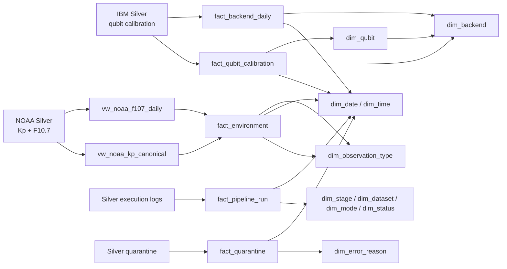
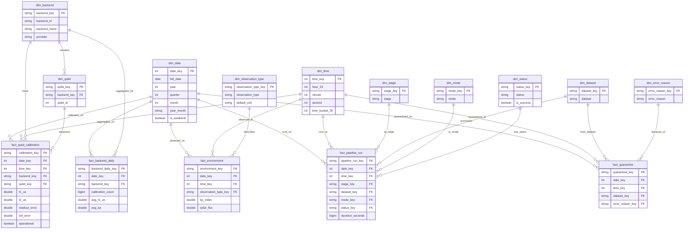
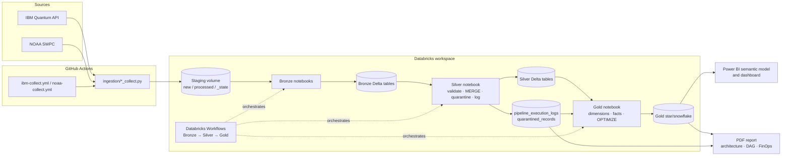

# Phase 3 Implementation Guide

- **Project:** Quantalytics
- **Scope:** Silver → Gold dimensional model, pipeline automation, Power BI dashboard, architecture/FinOps report
- **Workspace:** Databricks Free Edition, catalog `workspace`
- **Status:** Implementation blueprint. No Gold notebook, job, dashboard, or report exists yet.
- **Requirements source:** `Phase3/phase3.txt`
- **Deferred-work source:** `Phase3/Phase2_Leftovers.md`

Phase 2 is frozen. Phase 3 work creates new files and may fix Phase 2 defects as explicit Phase 3 changes, but it must not rewrite Phase 2 history or claim old evidence for new code.

## 1. What this guide produces

| Deliverable | File / location | Where it is run |
|---|---|---|
| Gold notebook | `spark/gold/1. Gold Pipeline.ipynb` | Databricks workspace, serverless or classic compute |
| Gold data dictionary and ER model | This document, §6–§7; optionally export to `docs/diagrams/phase3_gold_model.png` | Local/dbdiagram or draw.io |
| Databricks jobs | `databricks/jobs/quantalytics_ibm_job.json`, `databricks/jobs/quantalytics_noaa_job.json` | `databricks jobs create --json @...` or Workflows UI |
| Collector-to-job trigger | New step in `.github/workflows/ibm-collect.yml` and `noaa-collect.yml` | GitHub Actions |
| BI dashboard | `dashboard/Quantalytics.pbix` or published Power BI link | Power BI Desktop / Power BI Service |
| Final report | `report/Quantalytics_Phase3_Report.pdf` | Local Word/LaTeX/Markdown-to-PDF |
| Verification evidence | `Phase3/evidence/` screenshots, query output, DAG, FinOps captures | Databricks, Power BI, Azure |

Do not begin with Power BI. Build and validate Gold first; the semantic model depends on the actual Gold keys and row counts.

## 2. Execution order

1. Confirm the business questions and KPI definitions in §3.
2. Decide which Phase 2 remediation items are being fixed now and which are documented stopgaps (§4).
3. Create and run `spark/gold/1. Gold Pipeline.ipynb` manually with `mode=full` (§8).
4. Run the Gold acceptance queries in §8.8 and preserve the output.
5. Create the two Databricks jobs and test one manual incremental run (§9).
6. Add the `run-now` step to both collector workflows and test a real collector run (§9.3).
7. Build the Power BI semantic model and dashboard (§10).
8. Capture the Spark UI DAG and FinOps evidence (§11).
9. Write the PDF report, export the dashboard, and submit (§12).

Minimum viable path if time is short: Gold + jobs + dashboard + report, with the NOAA canonical views as a labelled stopgap. Do not silently ignore P0.1 or P0.3; state the coverage limitation in the report.

## 3. Business questions and KPI map

The Phase 1 document is not in the repository. Use these four questions, or replace them with the approved Phase 1 wording. Keep the IDs stable in the dashboard and report.

| ID | Business question | Gold source | Dashboard evidence |
|---|---|---|---|
| BQ1 | How do IBM QPU calibration metrics change over time by backend and qubit? | `fact_backend_daily`, `fact_qubit_calibration`, `dim_date` | Daily T1/T2 trend, backend comparison, qubit heat map |
| BQ2 | Which backends or qubits show the largest reliability degradation or variability? | `fact_qubit_calibration`, `fact_backend_daily`, `dim_qubit` | Distribution, top/bottom qubits, variance/error bars |
| BQ3 | Do QPU calibration metrics correlate with space-weather activity? | `fact_backend_daily`, `fact_environment`, `dim_observation_type` | Kp/F10.7 trend, scatter plot, correlation KPI |
| BQ4 | Is the pipeline reliable and is bad data under control? | `fact_pipeline_run`, `fact_quarantine`, dimension tables | Run-status timeline, failure list, quarantine Pareto |

Use these KPI definitions consistently:

- **Calibration rows:** count of qubit calibration measurements.
- **Average T1/T2:** arithmetic mean in microseconds, with nulls ignored.
- **Readout/init error:** dimensionless fraction in `[0, 1]`; display as a percentage.
- **Operational rate:** percentage of calibration rows where `operational = true`. This is currently not a real health signal because Phase 2 writes a constant `Yes`; label it accordingly until P1.1 is fixed.
- **Pipeline success rate:** successful log entries divided by all log entries in the selected period.
- **Quarantined rows:** count of rows in the quarantine fact, by dataset and reason.
- **Data freshness:** `now - max(silver_load_timestamp)`; not the same as source collection lag because Silver lacks per-row collection time (P1.4).

## 4. Phase 2 remediation gate

Every item below must appear in the final report as either **fixed** or **accepted limitation with evidence**. The detailed acceptance criteria remain in `Phase3/Phase2_Leftovers.md`; this is the Phase 3 action map.

| ID | Phase 3 action | Primary files | Done when |
|---|---|---|---|
| P0.1 | Normalize Kp to one 3-hourly decimal series; add overlap/backfill; make F10.7 unique by date | `ingestion/noaa_collect.py`, NOAA workflow, NOAA Bronze/Silver notebooks | One cadence, no duplicate Kp timestamps, gap closed, idempotent rerun |
| P0.2 | Add Databricks IBM/NOAA jobs with Bronze → Silver → Gold dependencies and retries | new `databricks/jobs/*.json`, workflows | One collector run triggers the full chain; failed stage blocks downstream |
| P0.3 | Make IBM history configurable and resumable; remove fixed 200 MB/5-per-day behavior; atomic watermark; logical Bronze dedupe | `ingestion/ibm_collect.py`, IBM workflow, Bronze notebook | Full backfill resumes, retry does not duplicate Bronze, Kingston gap filled or documented |
| P1.1 | Read real operational state from IBM payload; validate unexpected values | IBM collector/Bronze/Silver | Operational is not a constant; at least one non-operational state can be represented |
| P1.2 | Clip or reject records beyond the requested IBM end boundary | IBM collector | No future-dated row without override; test covers it |
| P1.3 | Add rolling overlap and revision semantics for both sources; log overlap | collectors, Bronze/Silver | Revised record updates; unchanged rerun inserts zero |
| P1.4 | Document the Gold contract; add gate table or explicitly exclude gate analysis; add collection timestamp only if lag is required | Silver notebook, docs | Every Gold metric has documented unit/grain; missing items explicit |
| P1.5 | Add `run_id` to quarantine, separate QA, remove production test writes, count inserted rows | Silver/quarantine tables, QA notebooks | Every quarantine row traceable; repeated run reports zero new bad rows |
| P1.6 | Add executable tests and CI for both datasets | `tests/`, `.github/workflows/*` | CI fails on regression; NOAA semantics covered |
| P1.7 | Fix setup guides, remove stale Silver README reference, add license, dependencies, remove placeholders | docs, `requirements.txt`, root | Reader can follow guides; no stale duplicate |
| P2.1 | Prefer OIDC/short-lived credentials; pin actions; document rotation | workflows | No floating action; scopes/lifetime documented |

### 4.1 NOAA stopgap for Gold

Until P0.1 is fixed, create two Gold views:

- `vw_noaa_kp_canonical`: historical 3-hourly Kp from full-load files only.
- `vw_noaa_f107_daily`: one F10.7 value per calendar date, preferring the historical full-load record.

These views prevent the mixed live/minute Kp series and duplicate-day F10.7 from contaminating the dashboard. They do **not** close the recent Kp gap. State that in the report and on the dashboard if Kp is shown.

### 4.2 IBM coverage warning

The current IBM full load is bounded by `TARGET_MB = 200` and five snapshots per day. Do not describe the Gold history as a complete year of IBM observations unless P0.3 is fixed. Use phrasing such as “available IBM calibration history” in the report.

### 4.3 Contract decision for Gold

Gold uses only these Silver fields:

- IBM: `record_key`, `backend_id`, `calibration_timestamp`, `qubit_id`, `t1_us`, `t2_us`, `readout_error`, `init_error`, `operational`, `source_file`, `load_timestamp`.
- NOAA: `record_key`, `source`, `observation_type`, `observation_timestamp`, `kp_index`, `solar_flux`, `source_unit`, `source_file`, `load_timestamp`.
- Operations: all 14 columns of `workspace.silver.pipeline_execution_logs`; six columns of `workspace.silver.quarantined_records`.

Gate metrics remain excluded because they are still only in Bronze `raw_payload`. Collection-lag analysis is excluded because Silver has no per-row collection timestamp. Record both exclusions in the report’s decision log.

## 5. Target Gold architecture



Design choice: a **star schema with one snowflaked dimension**. `dim_qubit` references `dim_backend`; all other dimensions attach directly to facts. This demonstrates a snowflake without making every query traverse an unnecessary hierarchy.

### 5.1 Grain and keys

| Table | Grain | Primary key | Foreign keys |
|---|---|---|---|
| `dim_date` | One calendar day | `date_key` | — |
| `dim_time` | One second of day | `time_key` | — |
| `dim_backend` | One IBM backend | `backend_key` | — |
| `dim_qubit` | One qubit on one backend | `qubit_key` | `backend_key` |
| `dim_observation_type` | One source observation type | `observation_type_key` | — |
| `dim_stage` | One pipeline stage | `stage_key` | — |
| `dim_dataset` | One dataset | `dataset_key` | — |
| `dim_mode` | One execution mode | `mode_key` | — |
| `dim_status` | One run status | `status_key` | — |
| `dim_error_reason` | One quarantine reason | `error_reason_key` | — |
| `fact_qubit_calibration` | One qubit measurement at one calibration timestamp | `calibration_key` | `date_key`, `time_key`, `backend_key`, `qubit_key` |
| `fact_environment` | One canonical Kp or F10.7 observation | `environment_key` | `date_key`, `time_key`, `observation_type_key` |
| `fact_backend_daily` | One backend per day | `backend_daily_key` | `date_key`, `backend_key` |
| `fact_pipeline_run` | One pipeline log row | `pipeline_run_key` | `date_key`, `time_key`, `stage_key`, `dataset_key`, `mode_key`, `status_key` |
| `fact_quarantine` | One quarantined record | `quarantine_key` | `date_key`, `time_key`, `dataset_key`, `error_reason_key` |

Delta Lake does not enforce primary or foreign keys. The notebook enforces uniqueness with `MERGE`; the report must say that keys are logical constraints enforced by pipeline logic.

### 5.2 Why these choices

- **Keep the atomic fact.** `fact_qubit_calibration` preserves the Silver grain for qubit-level analysis.
- **Add a daily fact.** `fact_backend_daily` is the dashboard performance layer: it removes repeated joins and lets trend visuals scan a few thousand rows.
- **Snowflake only `dim_qubit`.** It avoids repeating backend attributes and is small enough to join at query time.
- **Do not Hive-partition the small Gold tables.** The IBM fact is about 456k rows; NOAA and operations are much smaller. Hundreds of date partitions would create small-file overhead without a query benefit. Use `OPTIMIZE ... ZORDER` on date/backend and revisit Liquid Clustering only for a much larger future fact table.
- **No PII.** IBM and NOAA are public machine telemetry; there are no users, customers, addresses, or credentials in Silver/Gold. No masking is required. Never put tokens in notebooks or the dashboard.
- **Schema drift is handled before Gold.** Gold reads a fixed Silver contract. New source fields stay in Bronze `raw_payload` until a deliberate Silver promotion. Gold does not use `SELECT *` on Silver.
- **Incremental Gold.** A successful Gold run reprocesses a two-day overlap window and `MERGE`s facts by key. A full run overwrites the facts from full Silver. This handles late-arriving and corrected rows without duplicating them. For a correction older than two days, set `start_date` explicitly or run `mode=full`; the two-day window is a default, not a backfill mechanism.

## 6. Gold data dictionary

Types are Spark/Delta types. `*_key` columns are SHA-256 strings except date/time keys, which are integers for BI usability.

### 6.1 Dimensions

#### `workspace.gold.dim_date`

| Column | Type | Key | Description |
|---|---|---|---|
| `date_key` | INT | PK | `yyyyMMdd`, e.g. `20260925` |
| `full_date` | DATE | | Calendar date |
| `year` | INT | | Calendar year |
| `quarter` | INT | | 1–4 |
| `month` | INT | | 1–12 |
| `month_name` | STRING | | Full month name |
| `year_month` | STRING | | `yyyy-MM` sortable display label |
| `month_sort` | INT | | `year * 100 + month`; use as sort column |
| `day_of_month` | INT | | 1–31 |
| `day_name` | STRING | | Full weekday name |
| `week_of_year` | INT | | ISO-style Spark `weekofyear` |
| `is_weekend` | BOOLEAN | | Saturday/Sunday |

#### `workspace.gold.dim_time`

| Column | Type | Key | Description |
|---|---|---|---|
| `time_key` | INT | PK | `HHmmss`, e.g. `134500` |
| `hour_24` | INT | | 0–23 UTC |
| `minute` | INT | | 0–59 |
| `second` | INT | | 0–59 |
| `time_label` | STRING | | `HH:mm:ss` |
| `time_bucket_3h` | INT | | 0–7; three-hour NOAA bucket |
| `hour_bucket` | INT | | 0–23 |

#### `workspace.gold.dim_backend`

| Column | Type | Key | Description |
|---|---|---|---|
| `backend_key` | STRING | PK | SHA-256 of `backend_id` |
| `backend_id` | STRING | Unique | e.g. `ibm_fez` |
| `backend_name` | STRING | | Display name; initially same as ID |
| `provider` | STRING | | `IBM Quantum` |
| `first_seen` | TIMESTAMP | | Earliest IBM calibration timestamp |
| `last_seen` | TIMESTAMP | | Latest IBM calibration timestamp |

#### `workspace.gold.dim_qubit`

| Column | Type | Key | Description |
|---|---|---|---|
| `qubit_key` | STRING | PK | SHA-256 of `backend_id \|\| qubit_id` |
| `backend_key` | STRING | FK → `dim_backend` | Owning backend |
| `qubit_id` | INT | | IBM qubit number |
| `first_seen` | TIMESTAMP | | Earliest calibration timestamp |
| `last_seen` | TIMESTAMP | | Latest calibration timestamp |

#### `workspace.gold.dim_observation_type`

| Column | Type | Key | Description |
|---|---|---|---|
| `observation_type_key` | STRING | PK | SHA-256 of `observation_type` |
| `observation_type` | STRING | Unique | `planetary_kp` or `f10_7_flux` |
| `description` | STRING | | Human-readable definition |
| `default_unit` | STRING | | `index` or `sfu` |

#### `workspace.gold.dim_stage`

| Column | Type | Key | Description |
|---|---|---|---|
| `stage_key` | STRING | PK | SHA-256 of `stage` |
| `stage` | STRING | Unique | `Raw-to-Bronze`, `Bronze-to-Silver`, `Silver-to-Gold` |

#### `workspace.gold.dim_dataset`

| Column | Type | Key | Description |
|---|---|---|---|
| `dataset_key` | STRING | PK | SHA-256 of `dataset` |
| `dataset` | STRING | Unique | `ibm`, `noaa`, `gold` |

#### `workspace.gold.dim_mode`

| Column | Type | Key | Description |
|---|---|---|---|
| `mode_key` | STRING | PK | SHA-256 of `mode` |
| `mode` | STRING | Unique | `full`, `incremental`, `backfill` |

#### `workspace.gold.dim_status`

| Column | Type | Key | Description |
|---|---|---|---|
| `status_key` | STRING | PK | SHA-256 of `status` |
| `status` | STRING | Unique | `SUCCESS`, `FAILURE` |
| `is_success` | BOOLEAN | | Convenience flag |
| `is_failure` | BOOLEAN | | Convenience flag |

#### `workspace.gold.dim_error_reason`

| Column | Type | Key | Description |
|---|---|---|---|
| `error_reason_key` | STRING | PK | SHA-256 of full `error_reason` |
| `error_reason` | STRING | Unique | Full quarantine reason text, including compound reasons |

### 6.2 Facts

#### `workspace.gold.fact_qubit_calibration`

| Column | Type | Key | Description |
|---|---|---|---|
| `calibration_key` | STRING | PK | Silver `record_key`; deterministic |
| `date_key` | INT | FK → `dim_date` | Calibration UTC date |
| `time_key` | INT | FK → `dim_time` | Calibration UTC time |
| `backend_key` | STRING | FK → `dim_backend` | Backend |
| `qubit_key` | STRING | FK → `dim_qubit` | Qubit |
| `t1_us` | DOUBLE | | T1 in microseconds; nullable |
| `t2_us` | DOUBLE | | T2 in microseconds; nullable |
| `readout_error` | DOUBLE | | Readout assignment error, fraction |
| `init_error` | DOUBLE | | Initialization error, fraction; nullable |
| `operational` | BOOLEAN | | Source operational flag; currently constant in Phase 2 |
| `source_file` | STRING | | Silver lineage |
| `silver_load_timestamp` | TIMESTAMP | | When Silver processed the row |

#### `workspace.gold.fact_environment`

| Column | Type | Key | Description |
|---|---|---|---|
| `environment_key` | STRING | PK | Canonical Silver `record_key` |
| `date_key` | INT | FK → `dim_date` | Observation UTC date |
| `time_key` | INT | FK → `dim_time` | Observation UTC time; F10.7 canonicalized to 00:00:00 |
| `observation_type_key` | STRING | FK → `dim_observation_type` | Kp or F10.7 |
| `observation_type` | STRING | | Denormalized type for easy filtering/DAX |
| `kp_index` | DOUBLE | | Kp index 0–9 for Kp rows; null otherwise |
| `solar_flux` | DOUBLE | | F10.7 flux in sfu for flux rows; null otherwise |
| `source` | STRING | | NOAA source name |
| `source_file` | STRING | | Silver lineage |
| `silver_load_timestamp` | TIMESTAMP | | When Silver processed the row |

#### `workspace.gold.fact_backend_daily`

| Column | Type | Key | Description |
|---|---|---|---|
| `backend_daily_key` | STRING | PK | SHA-256 of `backend_id \|\| date_key` |
| `date_key` | INT | FK → `dim_date` | UTC date |
| `backend_key` | STRING | FK → `dim_backend` | Backend |
| `calibration_count` | BIGINT | | Distinct calibration timestamps for the backend/day |
| `qubit_count` | BIGINT | | Distinct qubits observed |
| `avg_t1_us` | DOUBLE | | Mean T1 |
| `min_t1_us` | DOUBLE | | Minimum T1 |
| `max_t1_us` | DOUBLE | | Maximum T1 |
| `avg_t2_us` | DOUBLE | | Mean T2 |
| `min_t2_us` | DOUBLE | | Minimum T2 |
| `max_t2_us` | DOUBLE | | Maximum T2 |
| `avg_readout_error` | DOUBLE | | Mean readout error fraction |
| `avg_init_error` | DOUBLE | | Mean init error fraction |
| `operational_measurement_pct` | DOUBLE | | Fraction of rows with `operational = true`; not a unique-qubit health rate |
| `avg_kp` | DOUBLE | | Mean canonical Kp for the date; nullable |
| `max_kp` | DOUBLE | | Maximum canonical Kp for the date; nullable |
| `avg_f107_solar_flux` | DOUBLE | | Canonical F10.7 for the date; nullable |

#### `workspace.gold.fact_pipeline_run`

| Column | Type | Key | Description |
|---|---|---|---|
| `pipeline_run_key` | STRING | PK | SHA-256 of run/stage/dataset/start time |
| `run_id` | STRING | | Original notebook run ID |
| `date_key` | INT | FK → `dim_date` | Run start UTC date |
| `time_key` | INT | FK → `dim_time` | Run start UTC time |
| `stage_key` | STRING | FK → `dim_stage` | Pipeline stage |
| `dataset_key` | STRING | FK → `dim_dataset` | Dataset |
| `mode_key` | STRING | FK → `dim_mode` | Execution mode |
| `status_key` | STRING | FK → `dim_status` | Outcome |
| `started_at` | TIMESTAMP | | Run start |
| `finished_at` | TIMESTAMP | | Run finish |
| `duration_seconds` | BIGINT | | Max of 0 and finish minus start |
| `input_rows` | BIGINT | | Input rows recorded by the stage |
| `rows_inserted` | BIGINT | | Inserted rows |
| `rows_updated` | BIGINT | | Updated rows |
| `rows_quarantined` | BIGINT | | Quarantined rows |
| `error_message` | STRING | | Failure or schema-drift message |
| `parameters` | STRING | | Original parameter text/JSON |

The current Gold run does not appear in this fact until the next Gold run, because the audit row is written after the fact is built. This is expected.

#### `workspace.gold.fact_quarantine`

| Column | Type | Key | Description |
|---|---|---|---|
| `quarantine_key` | STRING | PK | Silver quarantine `record_key` |
| `date_key` | INT | FK → `dim_date` | Quarantine load UTC date |
| `time_key` | INT | FK → `dim_time` | Quarantine load UTC time |
| `dataset_key` | STRING | FK → `dim_dataset` | Source dataset |
| `error_reason_key` | STRING | FK → `dim_error_reason` | Quarantine reason |
| `source_file` | STRING | | Original source file |
| `quarantined_at` | TIMESTAMP | | Silver quarantine load time |

There is no `run_id` in the Phase 2 quarantine table. Add it under P1.5; until then, this fact cannot attribute a bad row to a specific run.

## 7. ER diagram



For the report and PDF, render this diagram in dbdiagram/draw.io and include a high-resolution image. The Mermaid version is the source of truth for the relationships.

## 8. Build the Gold notebook

Create `spark/gold/1. Gold Pipeline.ipynb` in the repository and import/sync it into the Databricks workspace. Attach it to the same workspace/compute that can read `workspace.silver.*`.

Widget contract:

| Widget | Values | Use |
|---|---|---|
| `mode` | `full`, `incremental` | Full rebuild or date-window merge |
| `start_date` | `yyyy-MM-dd` or blank | Manual backfill/window override |
| `end_date` | `yyyy-MM-dd` or blank | Manual backfill/window override |
| `run_id` | blank or supplied | Optional orchestration correlation |

Run order: **all cells, top to bottom**. For the first run use `mode=full`; for scheduled jobs use `mode=incremental`.

### 8.1 Cell 1 — configuration and run window

```python
import json
import uuid
from datetime import date, datetime, timedelta, timezone

from delta.tables import DeltaTable
from pyspark.sql import functions as F
from pyspark.sql.types import LongType, StringType, StructField, StructType, TimestampType

spark.conf.set("spark.sql.session.timeZone", "UTC")

CATALOG = "workspace"
IBM_SILVER = f"{CATALOG}.silver.ibm_qubit_calibration"
NOAA_SILVER = f"{CATALOG}.silver.noaa_environment"
LOG_TABLE = f"{CATALOG}.silver.pipeline_execution_logs"
BAD_TABLE = f"{CATALOG}.silver.quarantined_records"
GOLD = f"{CATALOG}.gold"

def make_widget(name, kind, default, choices=None):
    try:
        dbutils.widgets.get(name)
    except Exception:
        if kind == "dropdown":
            dbutils.widgets.dropdown(name, default, choices)
        else:
            dbutils.widgets.text(name, default)

make_widget("mode", "dropdown", "full", ["full", "incremental"])
make_widget("start_date", "text", "")
make_widget("end_date", "text", "")
make_widget("run_id", "text", "")

MODE = dbutils.widgets.get("mode").lower().strip()
START_DATE = dbutils.widgets.get("start_date").strip()
END_DATE = dbutils.widgets.get("end_date").strip()
RUN_ID = dbutils.widgets.get("run_id").strip() or str(uuid.uuid4())

if MODE not in ("full", "incremental"):
    raise ValueError("mode must be full or incremental")

for value in (START_DATE, END_DATE):
    if value:
        datetime.strptime(value, "%Y-%m-%d")

for table in (IBM_SILVER, NOAA_SILVER, LOG_TABLE, BAD_TABLE):
    if not spark.catalog.tableExists(table):
        raise ValueError(f"Missing prerequisite table: {table}")

LAST_SUCCESS = spark.sql(f"""
    SELECT MAX(finished_at) AS finished_at
    FROM {LOG_TABLE}
    WHERE stage = 'Silver-to-Gold'
      AND dataset = 'gold'
      AND status = 'SUCCESS'
""").first()["finished_at"]

if MODE == "incremental" and not START_DATE:
    if LAST_SUCCESS:
        START_DATE = (LAST_SUCCESS.date() - timedelta(days=2)).isoformat()
    else:
        MODE = "full"

if MODE == "incremental" and not END_DATE:
    END_DATE = date.today().isoformat()

spark.sql(f"CREATE SCHEMA IF NOT EXISTS {GOLD}")
RUN_START = datetime.now(timezone.utc).replace(tzinfo=None)

print({
    "run_id": RUN_ID,
    "mode": MODE,
    "start_date": START_DATE or "ALL",
    "end_date": END_DATE or "ALL",
    "last_success": str(LAST_SUCCESS) if LAST_SUCCESS else None,
})
```

### 8.2 Cell 2 — logging continuation

The existing log table has no `rows_aggregated` column. Put that value in the JSON `parameters` field, and use `input_rows`/`rows_inserted` for source and written counts.

```python
LOG_SCHEMA = StructType([
    StructField("run_id", StringType(), False),
    StructField("stage", StringType(), False),
    StructField("dataset", StringType(), False),
    StructField("mode", StringType(), False),
    StructField("parameters", StringType(), True),
    StructField("started_at", TimestampType(), False),
    StructField("finished_at", TimestampType(), False),
    StructField("status", StringType(), False),
    StructField("input_rows", LongType(), False),
    StructField("rows_inserted", LongType(), False),
    StructField("rows_updated", LongType(), False),
    StructField("rows_quarantined", LongType(), False),
    StructField("error_message", StringType(), True),
    StructField("load_timestamp", TimestampType(), False),
])

spark.createDataFrame([], LOG_SCHEMA).write.format("delta").mode("ignore").saveAsTable(LOG_TABLE)

def audit(status, started, input_rows=0, rows_written=0, details=None, error=None):
    finished = datetime.now(timezone.utc).replace(tzinfo=None)
    parameters = json.dumps(
        {
            "start_date": START_DATE or "ALL",
            "end_date": END_DATE or "ALL",
            **(details or {}),
        },
        sort_keys=True,
    )
    row = [(
        RUN_ID,
        "Silver-to-Gold",
        "gold",
        MODE,
        parameters,
        started,
        finished,
        status,
        int(input_rows),
        int(rows_written),
        0,
        0,
        (error[:1500] if error else None),
        finished,
    )]
    spark.createDataFrame(row, LOG_SCHEMA).write.format("delta").mode("append").saveAsTable(LOG_TABLE)
```

### 8.3 Cell 3 — canonical NOAA views

```python
spark.sql(f"""
CREATE OR REPLACE VIEW {GOLD}.vw_noaa_kp_canonical AS
SELECT
    record_key,
    source,
    observation_type,
    observation_timestamp,
    kp_index,
    solar_flux,
    source_unit,
    source_file,
    load_timestamp
FROM {NOAA_SILVER}
WHERE observation_type = 'planetary_kp'
  AND source_file LIKE 'noaa_full_%'
  AND observation_timestamp IS NOT NULL
""")

spark.sql(f"""
CREATE OR REPLACE VIEW {GOLD}.vw_noaa_f107_daily AS
WITH ranked AS (
    SELECT
        record_key,
        source,
        observation_type,
        observation_timestamp,
        kp_index,
        solar_flux,
        source_unit,
        source_file,
        load_timestamp,
        ROW_NUMBER() OVER (
            PARTITION BY to_date(observation_timestamp)
            ORDER BY
                CASE WHEN source_file LIKE 'noaa_full_%' THEN 0 ELSE 1 END,
                observation_timestamp DESC
        ) AS rn
    FROM {NOAA_SILVER}
    WHERE observation_type = 'f10_7_flux'
      AND observation_timestamp IS NOT NULL
)
SELECT
    record_key,
    source,
    observation_type,
    to_timestamp(to_date(observation_timestamp)) AS observation_timestamp,
    kp_index,
    solar_flux,
    source_unit,
    source_file,
    load_timestamp
FROM ranked
WHERE rn = 1
""")
```

Replace the Kp view with the canonical 3-hourly source after P0.1. Do not make the view depend on `noaa_full_%` forever.

### 8.4 Cell 4 — dimensions

```python
def merge_dim(df, table, key):
    if not spark.catalog.tableExists(table):
        df.limit(0).write.format("delta").saveAsTable(table)
    if df.limit(1).count() == 0:
        return 0
    assignment = {column: f"s.`{column}`" for column in df.columns}
    (DeltaTable.forName(spark, table).alias("t")
        .merge(df.alias("s"), f"t.`{key}` = s.`{key}`")
        .whenMatchedUpdate(set=assignment)
        .whenNotMatchedInsertAll()
        .execute())
    return df.count()


bounds = spark.sql(f"""
    SELECT MIN(d) AS min_d, MAX(d) AS max_d
    FROM (
        SELECT to_date(calibration_timestamp) AS d FROM {IBM_SILVER}
        UNION ALL
        SELECT to_date(observation_timestamp) AS d FROM {NOAA_SILVER}
        UNION ALL
        SELECT to_date(started_at) AS d FROM {LOG_TABLE}
        UNION ALL
        SELECT to_date(load_timestamp) AS d FROM {BAD_TABLE}
    )
    WHERE d IS NOT NULL
""").first()

min_d = bounds["min_d"] or date(2024, 1, 1)
max_d = bounds["max_d"] or date.today()

dim_date = spark.sql(f"""
    SELECT
        CAST(date_format(d, 'yyyyMMdd') AS INT) AS date_key,
        d AS full_date,
        year(d) AS year,
        quarter(d) AS quarter,
        month(d) AS month,
        date_format(d, 'MMMM') AS month_name,
        date_format(d, 'yyyy-MM') AS year_month,
        CAST(year(d) * 100 + month(d) AS INT) AS month_sort,
        day(d) AS day_of_month,
        date_format(d, 'EEEE') AS day_name,
        weekofyear(d) AS week_of_year,
        dayofweek(d) IN (1, 7) AS is_weekend
    FROM (
        SELECT explode(sequence(to_date('{min_d}'), to_date('{max_d}'), interval 1 day)) AS d
    )
""")

dim_time = spark.sql("""
    SELECT
        CAST(date_format(ts, 'HHmmss') AS INT) AS time_key,
        hour(ts) AS hour_24,
        minute(ts) AS minute,
        second(ts) AS second,
        date_format(ts, 'HH:mm:ss') AS time_label,
        CAST((hour(ts) * 60 + minute(ts)) DIV 180 AS INT) AS time_bucket_3h,
        hour(ts) AS hour_bucket
    FROM (
        SELECT explode(sequence(
            to_timestamp('1970-01-01 00:00:00'),
            to_timestamp('1970-01-01 23:59:59'),
            interval 1 second
        )) AS ts
    )
""")

dim_backend = (
    spark.table(IBM_SILVER)
    .groupBy("backend_id")
    .agg(
        F.min("calibration_timestamp").alias("first_seen"),
        F.max("calibration_timestamp").alias("last_seen"),
    )
    .withColumn("backend_key", F.sha2(F.col("backend_id"), 256))
    .withColumn("backend_name", F.col("backend_id"))
    .withColumn("provider", F.lit("IBM Quantum"))
    .select("backend_key", "backend_id", "backend_name", "provider", "first_seen", "last_seen")
)

dim_qubit = (
    spark.table(IBM_SILVER)
    .groupBy("backend_id", "qubit_id")
    .agg(
        F.min("calibration_timestamp").alias("first_seen"),
        F.max("calibration_timestamp").alias("last_seen"),
    )
    .withColumn("qubit_key", F.sha2(F.concat_ws("||", "backend_id", "qubit_id"), 256))
    .withColumn("backend_key", F.sha2(F.col("backend_id"), 256))
    .select("qubit_key", "backend_key", "qubit_id", "first_seen", "last_seen")
)

dim_observation_type = (
    spark.createDataFrame(
        [
            ("planetary_kp", "Planetary K-index", "index"),
            ("f10_7_flux", "F10.7 solar radio flux", "sfu"),
        ],
        ["observation_type", "description", "default_unit"],
    )
    .withColumn("observation_type_key", F.sha2("observation_type", 256))
    .select("observation_type_key", "observation_type", "description", "default_unit")
)

dim_stage = (
    spark.sql(f"""
        SELECT DISTINCT stage FROM {LOG_TABLE} WHERE stage IS NOT NULL
        UNION SELECT 'Raw-to-Bronze'
        UNION SELECT 'Bronze-to-Silver'
        UNION SELECT 'Silver-to-Gold'
    """)
    .withColumn("stage_key", F.sha2("stage", 256))
    .select("stage_key", "stage")
)

dim_dataset = (
    spark.sql(f"""
        SELECT DISTINCT dataset FROM {LOG_TABLE} WHERE dataset IS NOT NULL
        UNION SELECT 'ibm'
        UNION SELECT 'noaa'
        UNION SELECT 'gold'
    """)
    .withColumn("dataset_key", F.sha2("dataset", 256))
    .select("dataset_key", "dataset")
)

dim_mode = (
    spark.sql(f"""
        SELECT DISTINCT mode FROM {LOG_TABLE} WHERE mode IS NOT NULL
        UNION SELECT 'full'
        UNION SELECT 'incremental'
        UNION SELECT 'backfill'
    """)
    .withColumn("mode_key", F.sha2("mode", 256))
    .select("mode_key", "mode")
)

dim_status = (
    spark.sql(f"""
        SELECT DISTINCT status FROM {LOG_TABLE} WHERE status IS NOT NULL
        UNION SELECT 'SUCCESS'
        UNION SELECT 'FAILURE'
    """)
    .withColumn("status_key", F.sha2("status", 256))
    .withColumn("is_success", F.col("status") == "SUCCESS")
    .withColumn("is_failure", F.col("status") == "FAILURE")
    .select("status_key", "status", "is_success", "is_failure")
)

dim_error_reason = (
    spark.table(BAD_TABLE)
    .where(F.col("error_reason").isNotNull())
    .select("error_reason")
    .distinct()
    .withColumn("error_reason_key", F.sha2("error_reason", 256))
    .select("error_reason_key", "error_reason")
)

merge_dim(dim_date, f"{GOLD}.dim_date", "date_key")
merge_dim(dim_time, f"{GOLD}.dim_time", "time_key")
merge_dim(dim_backend, f"{GOLD}.dim_backend", "backend_key")
merge_dim(dim_qubit, f"{GOLD}.dim_qubit", "qubit_key")
merge_dim(dim_observation_type, f"{GOLD}.dim_observation_type", "observation_type_key")
merge_dim(dim_stage, f"{GOLD}.dim_stage", "stage_key")
merge_dim(dim_dataset, f"{GOLD}.dim_dataset", "dataset_key")
merge_dim(dim_mode, f"{GOLD}.dim_mode", "mode_key")
merge_dim(dim_status, f"{GOLD}.dim_status", "status_key")
merge_dim(dim_error_reason, f"{GOLD}.dim_error_reason", "error_reason_key")
```

`dim_qubit` is physically linked to `dim_backend` through `backend_key`. Do not create a second active Power BI relationship from `dim_backend` directly to `fact_qubit_calibration`; it duplicates the filter path. Use `dim_backend → dim_qubit → fact_qubit_calibration`.

### 8.5 Cell 5 — fact helpers and windows

```python
def source_window(df, time_column):
    if MODE != "incremental":
        return df
    return df.where(
        F.to_date(F.col(time_column)).between(
            F.to_date(F.lit(START_DATE)),
            F.to_date(F.lit(END_DATE)),
        )
    )

def write_fact(df, table, key):
    row_count = df.count()
    if MODE == "full":
        (df.write.format("delta")
            .mode("overwrite")
            .option("overwriteSchema", "true")
            .saveAsTable(table))
    else:
        if not spark.catalog.tableExists(table):
            df.limit(0).write.format("delta").saveAsTable(table)
        assignment = {column: f"s.`{column}`" for column in df.columns}
        (DeltaTable.forName(spark, table).alias("t")
            .merge(df.alias("s"), f"t.`{key}` = s.`{key}`")
            .whenMatchedUpdate(set=assignment)
            .whenNotMatchedInsertAll()
            .execute())
    return row_count
```

### 8.6 Cell 6 — facts

```python
ibm_source = source_window(spark.table(IBM_SILVER), "calibration_timestamp")
noaa_source = source_window(spark.table(NOAA_SILVER), "observation_timestamp")
logs_source = source_window(spark.table(LOG_TABLE), "started_at")
bad_source = source_window(spark.table(BAD_TABLE), "load_timestamp")

ibm_input = ibm_source.count()
noaa_input = noaa_source.count()
logs_input = logs_source.count()
bad_input = bad_source.count()

fact_qubit = (
    ibm_source
    .withColumn("calibration_key", F.col("record_key"))
    .withColumn("date_key", F.date_format("calibration_timestamp", "yyyyMMdd").cast("int"))
    .withColumn(
        "time_key",
        (
            F.hour("calibration_timestamp") * 10000
            + F.minute("calibration_timestamp") * 100
            + F.second("calibration_timestamp")
        ).cast("int"),
    )
    .withColumn("backend_key", F.sha2("backend_id", 256))
    .withColumn("qubit_key", F.sha2(F.concat_ws("||", "backend_id", "qubit_id"), 256))
    .select(
        "calibration_key",
        "date_key",
        "time_key",
        "backend_key",
        "qubit_key",
        "t1_us",
        "t2_us",
        "readout_error",
        "init_error",
        "operational",
        "source_file",
        F.col("load_timestamp").alias("silver_load_timestamp"),
    )
)

def environment_projection(df):
    return df.select(
        F.col("record_key").alias("environment_key"),
        F.date_format("observation_timestamp", "yyyyMMdd").cast("int").alias("date_key"),
        (
            F.hour("observation_timestamp") * 10000
            + F.minute("observation_timestamp") * 100
            + F.second("observation_timestamp")
        ).cast("int").alias("time_key"),
        F.sha2("observation_type", 256).alias("observation_type_key"),
        "observation_type",
        "kp_index",
        "solar_flux",
        "source",
        "source_file",
        F.col("load_timestamp").alias("silver_load_timestamp"),
    )

fact_environment = (
    environment_projection(spark.table(f"{GOLD}.vw_noaa_kp_canonical"))
    .unionByName(environment_projection(spark.table(f"{GOLD}.vw_noaa_f107_daily")))
)

fact_backend_daily = (
    ibm_source
    .groupBy(F.to_date("calibration_timestamp").alias("full_date"), "backend_id")
    .agg(
        F.countDistinct("calibration_timestamp").alias("calibration_count"),
        F.countDistinct("qubit_id").alias("qubit_count"),
        F.avg("t1_us").alias("avg_t1_us"),
        F.min("t1_us").alias("min_t1_us"),
        F.max("t1_us").alias("max_t1_us"),
        F.avg("t2_us").alias("avg_t2_us"),
        F.min("t2_us").alias("min_t2_us"),
        F.max("t2_us").alias("max_t2_us"),
        F.avg("readout_error").alias("avg_readout_error"),
        F.avg("init_error").alias("avg_init_error"),
        F.avg(F.when(F.col("operational") == True, 1.0).otherwise(0.0)).alias(
            "operational_measurement_pct"
        ),
    )
    .withColumn("date_key", F.date_format("full_date", "yyyyMMdd").cast("int"))
    .withColumn("backend_key", F.sha2("backend_id", 256))
    .withColumn(
        "backend_daily_key",
        F.sha2(F.concat_ws("||", "backend_id", F.col("date_key")), 256),
    )
)

environment_table = spark.table(f"{GOLD}.fact_environment")
kp_daily = (
    environment_table
    .where(F.col("observation_type") == "planetary_kp")
    .groupBy("date_key")
    .agg(F.avg("kp_index").alias("avg_kp"), F.max("kp_index").alias("max_kp"))
)
f107_daily = (
    environment_table
    .where(F.col("observation_type") == "f10_7_flux")
    .groupBy("date_key")
    .agg(F.avg("solar_flux").alias("avg_f107_solar_flux"))
)

fact_backend_daily = (
    fact_backend_daily
    .join(kp_daily, "date_key", "left")
    .join(f107_daily, "date_key", "left")
    .select(
        "backend_daily_key",
        "date_key",
        "backend_key",
        "calibration_count",
        "qubit_count",
        "avg_t1_us",
        "min_t1_us",
        "max_t1_us",
        "avg_t2_us",
        "min_t2_us",
        "max_t2_us",
        "avg_readout_error",
        "avg_init_error",
        "operational_measurement_pct",
        "avg_kp",
        "max_kp",
        "avg_f107_solar_flux",
    )
)

fact_pipeline_run = (
    logs_source
    .withColumn("date_key", F.date_format("started_at", "yyyyMMdd").cast("int"))
    .withColumn(
        "time_key",
        (
            F.hour("started_at") * 10000
            + F.minute("started_at") * 100
            + F.second("started_at")
        ).cast("int"),
    )
    .withColumn("stage_key", F.sha2("stage", 256))
    .withColumn("dataset_key", F.sha2("dataset", 256))
    .withColumn("mode_key", F.sha2("mode", 256))
    .withColumn("status_key", F.sha2("status", 256))
    .withColumn(
        "duration_seconds",
        F.greatest(
            F.lit(0),
            F.unix_timestamp("finished_at") - F.unix_timestamp("started_at"),
        ),
    )
    .withColumn(
        "pipeline_run_key",
        F.sha2(
            F.concat_ws("||", "run_id", "stage", "dataset", F.col("started_at").cast("string")),
            256,
        ),
    )
    .select(
        "pipeline_run_key",
        "run_id",
        "date_key",
        "time_key",
        "stage_key",
        "dataset_key",
        "mode_key",
        "status_key",
        "started_at",
        "finished_at",
        "duration_seconds",
        "input_rows",
        "rows_inserted",
        "rows_updated",
        "rows_quarantined",
        "error_message",
        "parameters",
    )
)

fact_quarantine = (
    bad_source
    .withColumn("quarantine_key", F.col("record_key"))
    .withColumn("date_key", F.date_format("load_timestamp", "yyyyMMdd").cast("int"))
    .withColumn(
        "time_key",
        (
            F.hour("load_timestamp") * 10000
            + F.minute("load_timestamp") * 100
            + F.second("load_timestamp")
        ).cast("int"),
    )
    .withColumn("dataset_key", F.sha2("dataset", 256))
    .withColumn("error_reason_key", F.sha2("error_reason", 256))
    .select(
        "quarantine_key",
        "date_key",
        "time_key",
        "dataset_key",
        "error_reason_key",
        "source_file",
        F.col("load_timestamp").alias("quarantined_at"),
    )
)

FACT_TABLES = {
    "fact_qubit_calibration": (
        fact_qubit,
        f"{GOLD}.fact_qubit_calibration",
        "calibration_key",
    ),
    "fact_environment": (
        fact_environment,
        f"{GOLD}.fact_environment",
        "environment_key",
    ),
    "fact_backend_daily": (
        fact_backend_daily,
        f"{GOLD}.fact_backend_daily",
        "backend_daily_key",
    ),
    "fact_pipeline_run": (
        fact_pipeline_run,
        f"{GOLD}.fact_pipeline_run",
        "pipeline_run_key",
    ),
    "fact_quarantine": (
        fact_quarantine,
        f"{GOLD}.fact_quarantine",
        "quarantine_key",
    ),
}

print("Fact dataframes ready.")
```

If `fact_environment` is empty (for example, a blank test workspace), guard the `environment_projection` call before writing. In the real project both Silver source tables are populated.

### 8.7 Cell 7 — guarded writes, optimization, and audit

Keep the writes, optimization, and success/failure audit in one Python `try` block. This ensures a failed Gold write produces exactly one `Silver-to-Gold` failure row.

```python
optimizations = {
    f"{GOLD}.fact_qubit_calibration": "date_key, backend_key",
    f"{GOLD}.fact_environment": "date_key, observation_type_key",
    f"{GOLD}.fact_backend_daily": "date_key, backend_key",
    f"{GOLD}.fact_pipeline_run": "date_key, status_key",
    f"{GOLD}.fact_quarantine": "date_key, dataset_key",
}

try:
    FACT_ROWS = {
        name: write_fact(df, table, key)
        for name, (df, table, key) in FACT_TABLES.items()
    }

    for table, columns in optimizations.items():
        spark.sql(f"OPTIMIZE {table} ZORDER BY ({columns})")

    details = {
        "rows_aggregated": int(ibm_input),
        "noaa_rows_aggregated": int(noaa_input),
        "fact_rows": {key: int(value) for key, value in FACT_ROWS.items()},
    }
    audit(
        "SUCCESS",
        RUN_START,
        input_rows=ibm_input + noaa_input + logs_input + bad_input,
        rows_written=sum(FACT_ROWS.values()),
        details=details,
    )
    print("Gold build succeeded.", FACT_ROWS)
except Exception as exc:
    audit("FAILURE", RUN_START, error=str(exc))
    raise
```

Run `OPTIMIZE` only on compute that supports Delta `ZORDER`. If the environment rejects `ZORDER`, remove only the optimization loop, rerun the success audit, and record the limitation; use Liquid Clustering on a fresh table (`CLUSTER BY (date_key, backend_key)`) in a later rebuild. Do not report an optimization that did not run.

### 8.8 Cell 8 — Gold acceptance queries

```sql
SELECT 'fact_qubit_calibration' AS table_name, COUNT(*) AS rows
FROM workspace.gold.fact_qubit_calibration
UNION ALL
SELECT 'fact_environment', COUNT(*) FROM workspace.gold.fact_environment
UNION ALL
SELECT 'fact_backend_daily', COUNT(*) FROM workspace.gold.fact_backend_daily
UNION ALL
SELECT 'fact_pipeline_run', COUNT(*) FROM workspace.gold.fact_pipeline_run
UNION ALL
SELECT 'fact_quarantine', COUNT(*) FROM workspace.gold.fact_quarantine;

SELECT calibration_key, COUNT(*) AS n
FROM workspace.gold.fact_qubit_calibration
GROUP BY calibration_key
HAVING COUNT(*) > 1;

SELECT environment_key, COUNT(*) AS n
FROM workspace.gold.fact_environment
GROUP BY environment_key
HAVING COUNT(*) > 1;

SELECT backend_daily_key, COUNT(*) AS n
FROM workspace.gold.fact_backend_daily
GROUP BY backend_daily_key
HAVING COUNT(*) > 1;

SELECT pipeline_run_key, COUNT(*) AS n
FROM workspace.gold.fact_pipeline_run
GROUP BY pipeline_run_key
HAVING COUNT(*) > 1;

SELECT quarantine_key, COUNT(*) AS n
FROM workspace.gold.fact_quarantine
GROUP BY quarantine_key
HAVING COUNT(*) > 1;
```

```sql
SELECT COUNT(*) AS orphan_calibration_dates
FROM workspace.gold.fact_qubit_calibration f
LEFT ANTI JOIN workspace.gold.dim_date d ON f.date_key = d.date_key;

SELECT COUNT(*) AS orphan_calibration_backends
FROM workspace.gold.fact_qubit_calibration f
LEFT ANTI JOIN workspace.gold.dim_backend d ON f.backend_key = d.backend_key;

SELECT COUNT(*) AS orphan_calibration_qubits
FROM workspace.gold.fact_qubit_calibration f
LEFT ANTI JOIN workspace.gold.dim_qubit d ON f.qubit_key = d.qubit_key;

SELECT COUNT(*) AS orphan_environment_types
FROM workspace.gold.fact_environment f
LEFT ANTI JOIN workspace.gold.dim_observation_type d
  ON f.observation_type_key = d.observation_type_key;

SELECT COUNT(*) AS orphan_run_keys
FROM workspace.gold.fact_pipeline_run f
LEFT ANTI JOIN workspace.gold.dim_stage d ON f.stage_key = d.stage_key;

SELECT COUNT(*) AS bad_kp
FROM workspace.gold.fact_environment
WHERE observation_type = 'planetary_kp'
  AND (kp_index IS NULL OR kp_index < 0 OR kp_index > 9);

SELECT COUNT(*) AS duplicate_f107_days
FROM (
    SELECT date_key, COUNT(*) AS n
    FROM workspace.gold.fact_environment
    WHERE observation_type = 'f10_7_flux'
    GROUP BY date_key
    HAVING COUNT(*) > 1
);
```

Acceptance criteria:

- The full-run `fact_qubit_calibration` row count equals the current Silver IBM count (`456,612` at the 2026-10-23 baseline, unless new data has arrived).
- Duplicate and orphan checks return zero.
- `fact_environment` contains only one F10.7 row per `date_key`.
- The Kp count matches the number of canonical full-load Kp timestamps, not the mixed live feed.
- Running `mode=full` twice leaves fact counts unchanged (dimensions may update `first_seen`/`last_seen`, and the log deliberately grows).
- Running `mode=incremental` with no new data reports zero changed fact rows in `fact_pipeline_run` and does not duplicate Gold facts.

## 9. Orchestration with Databricks jobs

### 9.1 Job design

Create two jobs:

- `quantalytics-ibm-pipeline`: `ibm_bronze → ibm_silver → gold`
- `quantalytics-noaa-pipeline`: `noaa_bronze → noaa_silver → gold`

Both jobs use these job parameters: `mode`, `source_file`, `start_date`, `end_date`.

The Gold task is attached to both jobs. It is idempotent, so the second dataset’s job can safely refresh Gold again. If the two jobs run at the same time, set `max_concurrent_runs: 1` on each and let the Gold `MERGE` serialize its writes. For a full rebuild, run one job at a time because both jobs overwrite Gold facts.

The Bronze notebooks have no widgets. The Silver notebook requires `source_file` for `incremental` and a date range for `backfill`. For a normal incremental run, pass the uploaded file name. For a full run, leave it blank.

### 9.2 Job JSON template

Create `databricks/jobs/quantalytics_ibm_job.json` from the template below. Replace the notebook paths and cluster settings with the workspace’s actual Repos path and compute. Keep the parameter names exactly.

```json
{
  "name": "quantalytics-ibm-pipeline",
  "max_concurrent_runs": 1,
  "parameters": [
    {"name": "mode", "default": "incremental"},
    {"name": "source_file", "default": ""},
    {"name": "start_date", "default": ""},
    {"name": "end_date", "default": ""}
  ],
  "tasks": [
    {
      "task_key": "ibm_bronze",
      "notebook_task": {
        "notebook_path": "/Workspace/Repos/<user>/Quantalytics/spark/bronze/ibm_bronze_load"
      },
      "existing_cluster_id": "<CLUSTER_ID>",
      "timeout_seconds": 3600,
      "max_retries": 1
    },
    {
      "task_key": "ibm_silver",
      "depends_on": [{"task_key": "ibm_bronze"}],
      "notebook_task": {
        "notebook_path": "/Workspace/Repos/<user>/Quantalytics/spark/silver/1. Silver Pipeline",
        "base_parameters": {
          "dataset": "ibm",
          "mode": "{{job.parameters.mode}}",
          "source_file": "{{job.parameters.source_file}}",
          "start_date": "{{job.parameters.start_date}}",
          "end_date": "{{job.parameters.end_date}}"
        }
      },
      "existing_cluster_id": "<CLUSTER_ID>",
      "timeout_seconds": 3600,
      "max_retries": 1
    },
    {
      "task_key": "gold",
      "depends_on": [{"task_key": "ibm_silver"}],
      "notebook_task": {
        "notebook_path": "/Workspace/Repos/<user>/Quantalytics/spark/gold/1. Gold Pipeline",
        "base_parameters": {
          "mode": "{{job.parameters.mode}}",
          "start_date": "{{job.parameters.start_date}}",
          "end_date": "{{job.parameters.end_date}}"
        }
      },
      "existing_cluster_id": "<CLUSTER_ID>",
      "timeout_seconds": 3600,
      "max_retries": 1
    }
  ]
}
```

For NOAA, copy the file, change `name` to `quantalytics-noaa-pipeline`, change the Bronze path, and set Silver `dataset` to `noaa`.

Create and test:

```bash
databricks jobs create --json @databricks/jobs/quantalytics_ibm_job.json
databricks jobs create --json @databricks/jobs/quantalytics_noaa_job.json
databricks jobs list --output json
```

If the workspace uses serverless jobs instead of an existing cluster, replace `existing_cluster_id` with the serverless environment block supported by that workspace. The job-level parameters and `depends_on` structure stay the same.

### 9.3 Trigger the job after collection

Add a step after the upload/watermark step in each workflow. The step must run only when a new file was actually uploaded. The example is for IBM; change the job-ID variable and file glob for NOAA.

```yaml
      - name: Trigger the Databricks IBM pipeline
        if: env.MODE != 'smoke'
        env:
          DATABRICKS_HOST: ${{ secrets.DATABRICKS_HOST }}
          DATABRICKS_TOKEN: ${{ secrets.DATABRICKS_TOKEN }}
        run: |
          set -e
          shopt -s nullglob
          files=(output/ibm_*.csv)
          if [ ${#files[@]} -eq 0 ]; then
            echo "No uploaded IBM batch; no job trigger."
            exit 0
          fi
          SOURCE_FILE="$(basename "${files[0]}")"
          curl -fsS -X POST "$DATABRICKS_HOST/api/2.1/jobs/run-now" \
            -H "Authorization: Bearer $DATABRICKS_TOKEN" \
            -H "Content-Type: application/json" \
            -d "{\"job_id\": ${{ vars.DATABRICKS_IBM_JOB_ID }}, \"job_parameters\": {\"mode\": \"$MODE\", \"source_file\": \"$SOURCE_FILE\", \"start_date\": \"\", \"end_date\": \"\"}}"
```

For NOAA, use `output/noaa_*.jsonl` and `vars.DATABRICKS_NOAA_JOB_ID`.

The collectors normally emit one batch per run, so `files[0]` is sufficient. If a run ever emits multiple files, trigger once per file or add a batch-pattern parameter to Silver; do not silently process only the first file and call the batch complete.

Do not log the token. Do not put a PAT in the repository. P2.1 still applies: prefer OIDC/short-lived credentials and pin `databricks/setup-cli` to a version or SHA.

### 9.4 Orchestration acceptance

1. Upload one new IBM file with the collector. The GitHub run must finish green and start `quantalytics-ibm-pipeline`.
2. In the job run graph, Bronze succeeds, Silver succeeds, Gold succeeds.
3. Break the Silver source-file parameter deliberately in a test job. Bronze succeeds, Silver fails, Gold is skipped (not silently run). The failed Silver row is visible in `pipeline_execution_logs`.
4. Re-run the same job. Silver reports no new business rows; Gold facts stay unique; the Gold log adds one row.
5. Record the job run URL, Gold log row, and Gold fact counts as evidence.

## 10. Power BI semantic model and dashboard

### 10.1 Connect

1. Open Power BI Desktop.
2. `Get Data → Azure → Azure Databricks` (or the Databricks partner connector).
3. Enter the workspace server hostname and SQL warehouse HTTP path.
4. Authenticate with Microsoft Entra ID or the workspace-supported method.
5. Select the `workspace.gold` tables and the two views. Do not import Bronze or Silver into the semantic model.
6. Choose **Import** for the academic dataset. It is small enough and gives stable screenshots. DirectQuery is acceptable but slower and less predictable for a live demo.

### 10.2 Relationships

Configure single-direction, many-to-one relationships from each fact to its dimension:

| From (fact) | To (dimension) | Cardinality | Filter |
|---|---|---|---|
| `fact_qubit_calibration[date_key]` | `dim_date[date_key]` | Many-to-one | Single |
| `fact_qubit_calibration[time_key]` | `dim_time[time_key]` | Many-to-one | Single |
| `fact_qubit_calibration[qubit_key]` | `dim_qubit[qubit_key]` | Many-to-one | Single |
| `dim_qubit[backend_key]` | `dim_backend[backend_key]` | Many-to-one | Single |
| `fact_environment[date_key]` | `dim_date[date_key]` | Many-to-one | Single |
| `fact_environment[time_key]` | `dim_time[time_key]` | Many-to-one | Single |
| `fact_environment[observation_type_key]` | `dim_observation_type[observation_type_key]` | Many-to-one | Single |
| `fact_backend_daily[date_key]` | `dim_date[date_key]` | Many-to-one | Single |
| `fact_backend_daily[backend_key]` | `dim_backend[backend_key]` | Many-to-one | Single |
| `fact_pipeline_run[date_key]` | `dim_date[date_key]` | Many-to-one | Single |
| `fact_pipeline_run[time_key]` | `dim_time[time_key]` | Many-to-one | Single |
| `fact_pipeline_run[stage_key]` | `dim_stage[stage_key]` | Many-to-one | Single |
| `fact_pipeline_run[dataset_key]` | `dim_dataset[dataset_key]` | Many-to-one | Single |
| `fact_pipeline_run[mode_key]` | `dim_mode[mode_key]` | Many-to-one | Single |
| `fact_pipeline_run[status_key]` | `dim_status[status_key]` | Many-to-one | Single |
| `fact_quarantine[date_key]` | `dim_date[date_key]` | Many-to-one | Single |
| `fact_quarantine[time_key]` | `dim_time[time_key]` | Many-to-one | Single |
| `fact_quarantine[dataset_key]` | `dim_dataset[dataset_key]` | Many-to-one | Single |
| `fact_quarantine[error_reason_key]` | `dim_error_reason[error_reason_key]` | Many-to-one | Single |

Do **not** add `dim_backend → fact_qubit_calibration` as an active relationship; the path through `dim_qubit` already filters that fact. Keep the fact’s `backend_key` for lineage and optional inactive relationships.

Semantic-model rules:

- Mark `dim_date` as the date table using `full_date`.
- Sort `month_name` by `month_sort`.
- Hide every `*_key`, `run_id`, `source_file`, and `source_payload_hash` from report view.
- Rename columns to friendly labels: `T1 (µs)`, `T2 (µs)`, `Readout error`, `Kp index`, `F10.7 flux (sfu)`, `Run duration (s)`.
- Format `readout_error`, `init_error`, and `operational_measurement_pct` as percentages; T1/T2 with one decimal and `µs`.
- Set `dim_date`/`dim_time` filtering to single direction toward facts.
- Do not create calculated columns that duplicate Gold measures.

### 10.3 DAX measures

```dax
Calibration Rows = COUNTROWS ( fact_qubit_calibration )

Avg T1 (µs) = AVERAGE ( fact_qubit_calibration[t1_us] )

Avg T2 (µs) = AVERAGE ( fact_qubit_calibration[t2_us] )

Readout Error % =
AVERAGE ( fact_qubit_calibration[readout_error] ) * 100

Init Error % =
AVERAGE ( fact_qubit_calibration[init_error] ) * 100

Operational Rate % =
DIVIDE (
    CALCULATE (
        COUNTROWS ( fact_qubit_calibration ),
        fact_qubit_calibration[operational] = TRUE ()
    ),
    COUNTROWS ( fact_qubit_calibration )
) * 100

Daily Avg T1 (µs) = AVERAGE ( fact_backend_daily[avg_t1_us] )

Daily Avg T2 (µs) = AVERAGE ( fact_backend_daily[avg_t2_us] )

Avg Kp =
CALCULATE (
    AVERAGE ( fact_environment[kp_index] ),
    dim_observation_type[observation_type] = "planetary_kp"
)

Avg F10.7 (sfu) =
CALCULATE (
    AVERAGE ( fact_environment[solar_flux] ),
    dim_observation_type[observation_type] = "f10_7_flux"
)

Calibration vs Kp Correlation =
CALCULATE (
    CORREL ( fact_backend_daily[avg_t1_us], fact_backend_daily[avg_kp] )
)

Pipeline Runs = COUNTROWS ( fact_pipeline_run )

Pipeline Success % =
DIVIDE (
    CALCULATE (
        COUNTROWS ( fact_pipeline_run ),
        dim_status[status] = "SUCCESS"
    ),
    COUNTROWS ( fact_pipeline_run )
) * 100

Failed Runs =
CALCULATE (
    COUNTROWS ( fact_pipeline_run ),
    dim_status[status] = "FAILURE"
)

Quarantined Rows = COUNTROWS ( fact_quarantine )

Latest Silver Load = MAX ( fact_qubit_calibration[silver_load_timestamp] )

Data Freshness (hours) =
DATEDIFF ( MAX ( fact_qubit_calibration[silver_load_timestamp] ), NOW (), HOUR )
```

`CORREL` returns blank when there are fewer than two complete pairs; if it errors in the local Power BI version, use `CALCULATE(AVERAGE(...))` and compute correlation in SQL for the report instead. Document whichever method is used.

### 10.4 Dashboard pages

Use four pages and at least eight visuals. Each visual must be populated from Gold, not Silver.

**Page 1 — QPU health overview**

- KPI cards: calibration rows, average T1, average T2, pipeline success %, quarantined rows.
- Line chart: daily average T1 and T2 by date, split by backend. This uses `fact_backend_daily`.
- Column chart: average T1 by backend with date slicer.
- Slicers: date, backend, qubit.

**Page 2 — Backend and qubit reliability**

- Matrix/heat map: backend × date, colored by average T1 or readout error.
- Distribution: histogram of T1 or readout error from `fact_qubit_calibration`.
- Top/bottom qubits: bar chart filtered by backend and selected date range.
- Footnote that operational rate is not a real signal until P1.1 is fixed.

**Page 3 — Space weather**

- Dual-axis line chart: daily average Kp and daily average T1 by date.
- Scatter: daily average Kp (x) versus daily average T1 (y), colored by backend, with slicer.
- F10.7 trend line.
- Correlation KPI from the DAX measure, labelled as exploratory association, not causation.

**Page 4 — Pipeline and audit**

- Stacked column/line: pipeline runs by date, split by success/failure.
- Bar chart: run duration and input rows by stage.
- Pareto: quarantined rows by error reason.
- Table: latest failed runs with `dataset`, `stage`, `mode`, `error_message`, `finished_at`.
- Use `fact_pipeline_run` and `fact_quarantine`.

Add a visible data-coverage note: “Kp is historical 3-hourly only until NOAA ingestion is rebuilt; IBM history is sampled/bounded (see report).”

### 10.5 Publish and export

1. Save `dashboard/Quantalytics.pbix`.
2. Publish to the Power BI Service workspace if the assignment requires a link.
3. Refresh the dataset and verify the four pages on the published version.
4. Export a PDF of the dashboard pages for the report appendix.
5. Keep the `.pbix` in the repository or submit the published link as required by the course.

### 10.6 Tableau alternative

If using Tableau Desktop:

- Connect with the Databricks connector to the same Gold schema.
- Define physical/logical relationships matching §10.2.
- Create calculated fields equivalent to §10.3.
- Build the same four pages.
- Save `dashboard/Quantalytics.twbx` and publish/export a PDF.
- The report must name the tool actually used; do not claim Power BI screenshots if Tableau was used.

## 11. Report, DAG, and FinOps

### 11.1 Architecture diagram

Use this Mermaid diagram as the report’s source, then export a clean PNG/PDF:



The report must show the actual flow, including the GitHub Actions trigger to Databricks. Label the NOAA Gold view as a stopgap.

### 11.2 Decision log

Write a table in the PDF with these rows:

| Decision | Alternatives considered | Why | Evidence |
|---|---|---|---|
| Star schema with one snowflaked `dim_qubit` | Pure star; fully normalized snowflake | Keeps BI joins simple while separating backend attributes | ER diagram; Power BI model |
| Add `fact_backend_daily` | Query `fact_qubit_calibration` directly | Dashboard trends scan far fewer rows; preserves atomic fact for deep dives | Gold row counts and visual performance |
| No Hive partitioning on small facts; `OPTIMIZE ZORDER` | Partition by date; Liquid Clustering from day one | 456k rows do not justify small-file overhead; ZORDER improves date/backend reads | `OPTIMIZE` output; row counts |
| Incremental Gold via 2-day overlap and MERGE | Full overwrite every run | Handles late corrections while keeping reruns idempotent | Gold rerun counts; log rows |
| Full mode overwrites facts | MERGE for every mode | Deliberate rebuild path for contract changes | Acceptance test rerun |
| Reuse Phase 2 log table | New Gold audit table | Requirement says continue existing logging; one run history | `Silver-to-Gold` log rows |
| NOAA canonical views as a stopgap | Mix live and historical Kp | Avoids publishing an internally inconsistent Kp series | View definitions; coverage note |
| Exclude gate metrics and collection-lag KPIs | Add them to Silver first | They are not in the Silver contract; no invented fields | §4.3 and report limitations |
| No PII controls beyond access control | Tokenization/masking | Dataset contains public machine telemetry, no personal data | Data dictionary |
| Import mode in Power BI | DirectQuery | Small data, stable screenshots, simpler academic demo | `.pbix` and refresh test |

Add the exact Phase 2 decisions that still apply: explicit schemas, `try_cast`, quarantine, SHA-256 logical keys, and idempotent Silver `MERGE`. Do not contradict the Phase 2 documentation.

### 11.3 Spark UI and DAG

Capture evidence, not a hand-drawn DAG:

1. Run `mode=full` once and open the Databricks job/notebook run.
2. Open **Spark UI → SQL / DataFrame** and select the query for `fact_backend_daily`.
3. Take a screenshot showing the aggregation and joins.
4. In the report, annotate:
   - the Silver scan with predicate pushdown on the date window;
   - the `groupBy`/aggregate exchange (shuffle) for backend/date;
   - the broadcast or merge join used for the small Kp/F10.7 daily aggregates;
   - the final write/merge and any AQE coalescing.
5. Confirm the explanation against the actual graph. Do not claim predicate pushdown or broadcast if the graph does not show it.

If the saved UI does not retain the query, rerun the Gold job with the same parameters and capture the new run. Store the image in `Phase3/evidence/`.

### 11.4 FinOps worksheet

Use actual usage, not invented numbers. Sources:

- Databricks account console → Usage / billing → filter by workspace and job.
- Azure Cost Management → Databricks → filtered date range.
- Databricks job run duration and cluster DBU rate.
- Storage: Unity Catalog volume and Delta table sizes from the workspace.

Build a table with these columns:

| Field | Value |
|---|---|
| Measurement period | |
| Typical daily incremental runs | |
| Average Gold run duration (minutes) | |
| Average Bronze + Silver run duration (minutes) | |
| Compute type / DBU rate | |
| Compute cost per daily run | |
| Storage GB-month | |
| Storage cost per month | |
| SQL warehouse / BI refresh cost | |
| Total measured monthly cost | |

Formulas:

```text
compute_hours = duration_minutes / 60
DBUs = compute_hours × DBU_rate
compute_cost = DBUs × price_per_DBU
monthly_cost = sum(compute_cost for all runs) + storage + BI warehouse
annual_cost = monthly_cost × 12
hourly_annual = 24 × 365 × cost_per_hourly_run
```

Enterprise scenario: if the pipeline ran hourly instead of weekly/daily, multiply the measured per-run compute cost by `24 × 365`, then explain why that is wasteful for this source cadence. Optimization levers:

- Incremental Silver and Gold merges instead of full overwrites.
- Date-window pruning and two-day overlap only.
- Job clusters/serverless with auto-termination; no always-on all-purpose cluster.
- Right-size workers; IBM/NOAA data is small.
- Weekly `OPTIMIZE` rather than after every run.
- Partition pruning and ZORDER on date/backend.
- Cache only within a query if the DAG shows reuse.
- Do not schedule hourly when the source is weekly; align cadence with the collectors.
- Keep BI in Import mode and refresh once per data update.

State assumptions explicitly. If actual DBU pricing is unavailable, show the measured DBUs/hours and say the price assumption is an estimate; do not present a fabricated exact bill.

### 11.5 PDF report outline

1. Cover: project title, student/team, course, date, repository link, dashboard link/file.
2. Executive summary: problem, datasets, medallion architecture, results, limitations.
3. Architecture diagram and end-to-end flow.
4. Data model: Gold ER diagram, grain, keys, data dictionary summary.
5. Pipeline and orchestration: Bronze → Silver → Gold, jobs, failure propagation, logging.
6. BI: semantic model, relationships, dashboard screenshots, business-question answers.
7. Engineering decisions: decision log from §11.2.
8. Spark DAG analysis: screenshot and explanation.
9. FinOps: measured usage, annual scenario, optimizations.
10. Data quality and Phase 2 leftovers: P0/P1/P2 status, stopgaps, evidence.
11. Limitations and future work.
12. Appendix: reproduction steps, query output, job IDs, file inventory.

### 11.6 Submission checklist

- [ ] GitHub repository contains the Gold notebook, job JSON/YAML, updated workflows, tests, and report source.
- [ ] Gold tables exist in `workspace.gold` and acceptance queries pass.
- [ ] Gold log contains successful `Silver-to-Gold` rows with rows aggregated and duration.
- [ ] A manual incremental run and a scheduled/triggered run are evidenced.
- [ ] Power BI `.pbix` or published link works and refreshes.
- [ ] Dashboard has at least three distinct visuals; the intended model has eight.
- [ ] Audit/error visuals use `fact_pipeline_run` and `fact_quarantine`.
- [ ] ER diagram and data dictionary match the deployed tables.
- [ ] Spark UI DAG screenshot is real and annotated accurately.
- [ ] FinOps numbers come from actual usage or are explicitly labelled estimates.
- [ ] PDF states P0.1/P0.3 limitations instead of hiding them.
- [ ] No secrets, tokens, PATs, or personal data are committed.
- [ ] Phase 2 documents were not rewritten to claim Phase 3 work.

## 12. Evidence to capture while implementing

Save these in `Phase3/evidence/`:

- `gold_full_run_counts.txt`: output of §8.8.
- `gold_rerun_counts.txt`: same queries after an idempotent rerun.
- `gold_log_rows.csv`: the `Silver-to-Gold` rows.
- `job_graph.png`: Databricks job graph showing Bronze → Silver → Gold.
- `spark_dag.png`: Spark UI DAG for `fact_backend_daily`.
- `dashboard_page_*.png`: four dashboard pages.
- `pipeline_run_failure.png`: failed-stage evidence.
- `finops_usage.png` and `finops_worksheet.csv`: actual usage and calculations.
- `phase2_limitations.md`: the exact fixed/stopgap status of each backlog item.

## 13. Definition of done

Phase 3 is complete only when all of these are true:

1. `fact_qubit_calibration`, `fact_environment`, `fact_backend_daily`, `fact_pipeline_run`, and `fact_quarantine` exist and have unique keys.
2. The Gold ER model and data dictionary match the deployed schema.
3. A collector run or manual job run can execute Bronze → Silver → Gold without notebook-by-notebook intervention.
4. Gold is logged with `Silver-to-Gold`, row counts, and execution time.
5. Power BI/Tableau connects to Gold, has correct relationships, and answers BQ1–BQ4.
6. The dashboard includes audit/error visuals and at least three distinct visual types.
7. The PDF contains the architecture, decision log, real DAG analysis, and actual FinOps evaluation.
8. The repository, dashboard file/link, and PDF are ready to submit, with P0 limitations stated honestly.
