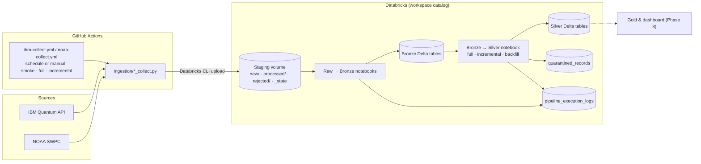
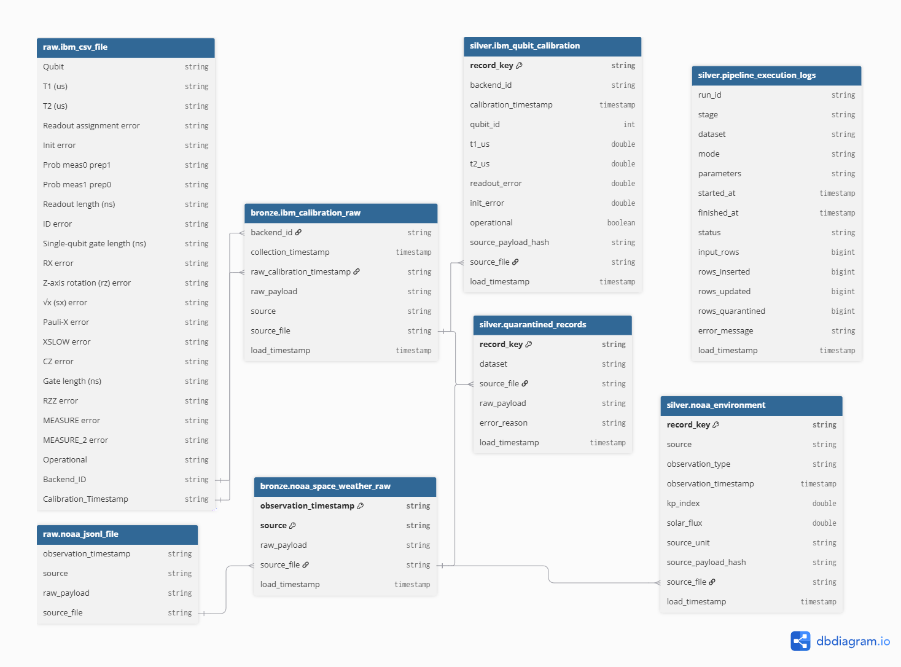

# Quantalytics

**Data Analysis and Visualisation — Semester Project**
**Phase 2: Apache Spark Bronze and Silver Lakehouse Pipeline**

Quantalytics studies the reliability of IBM quantum processors (QPUs) over time and compares their calibration measurements with NOAA space-weather observations. Phase 2 builds the Bronze and Silver layers on **Databricks, PySpark and Delta Lake** (Medallion architecture):

```
IBM Quantum API ─┐                                   ┌─ Bronze (raw, STRING) ─┐
                 ├─ collectors (GitHub Actions) ─►  staging volume ─►           ├─► Silver (typed, validated) ─► Gold (Phase 3)
NOAA SWPC ───────┘      new/ → processed/ | rejected/ └────────────────────────┘
```

Gold analytics and the dashboard are **not** part of Phase 2.

## 1. Repository layout

| Path | Purpose |
| --- | --- |
| `ingestion/` | Collectors (`ibm_collect.py`, `noaa_collect.py`) that fetch source data. Run by the workflows in `.github/workflows/`, which copy each batch into the Databricks staging volume `new/` folder. |
| `notebooks/00_setup_databricks.ipynb` | Creates the schemas (`landing`, `bronze`, `silver`, `gold`) and the staging volume. |
| `spark/bronze/ibm_bronze_load.ipynb` | **Raw → Bronze**, IBM CSV files. |
| `spark/bronze/noaa_bronze_load.ipynb` | **Raw → Bronze**, NOAA JSON Lines files. |
| `spark/silver/1. Silver Pipeline.ipynb` | **Bronze → Silver**, both datasets: validation, `MERGE`, quarantine, logging. |
| `spark/silver/tests/` | Schema-drift, quarantine and Silver QA notebooks. |
| `data/` | Small samples (`data/sample/`) and generation scripts. |

## Workflow:


## 2. Data models

All tables live in the `workspace` catalog. **Delta Lake does not enforce primary keys.** The *primary key* below is the logical key the pipeline relies on, and the column "How it is enforced" says what actually prevents duplicates.

### 2.0 Data model diagram
 
<p align="center">
  
</p>

<p align="center"><em>Figure 1 - Raw → Bronze → Silver data models and operational tables. Arrows show lineage (derived column → its origin), not enforced foreign keys. <code>[pk]</code> marks the logical primary key; Delta Lake does not enforce keys.</em>
</p>

* 📄 [Download the diagram as PDF](docs/diagrams/quantalytics_data_models.pdf)
* 🧩 [Diagram source (DBML)](docs/diagrams/quantalytics_data_models.dbml)
* 🔗 [Interactive diagram on dbdiagram.io](https://dbdiagram.io/d/6abd5a0babcc87fb7ab81c2d)

| Layer | Tables |
| --- | --- |
| Raw (staging volume files) | `raw.ibm_csv_file`, `raw.noaa_jsonl_file` |
| Bronze | `bronze.ibm_calibration_raw`, `bronze.noaa_space_weather_raw` |
| Silver | `silver.ibm_qubit_calibration`, `silver.noaa_environment` |
| Operational | `silver.pipeline_execution_logs`, `silver.quarantined_records` |
 

### 2.1 Raw input schemas (explicit `StructType`, no `inferSchema`)

* **IBM CSV** — 23 columns, all `StringType`, in this order: `Qubit`, `T1 (us)`, `T2 (us)`, `Readout assignment error`, `Init error`, `Prob meas0 prep1`, `Prob meas1 prep0`, `Readout length (ns)`, `ID error`, `Single-qubit gate length (ns)`, `RX error`, `Z-axis rotation (rz) error`, `√x (sx) error`, `Pauli-X error`, `XSLOW error`, `CZ error`, `Gate length (ns)`, `RZZ error`, `MEASURE error`, `MEASURE_2 error`, `Operational`, `Backend_ID`, `Calibration_Timestamp`.
* **NOAA JSONL** — `observation_timestamp`, `source`, `raw_payload`, `source_file` (all `StringType`).

### 2.2 Bronze — `workspace.bronze.ibm_calibration_raw`

| Column | Type | Meaning |
| --- | --- | --- |
| `backend_id` | STRING | IBM processor identifier (from `Backend_ID`). |
| `collection_timestamp` | TIMESTAMP | When the collector fetched the file (parsed from the file name). |
| `raw_calibration_timestamp` | STRING | Original calibration time, uncast. |
| `raw_payload` | STRING | The full source row as JSON text (all 23 columns, plus any new columns). |
| `source` | STRING | `ibm_quantum_platform`. |
| `source_file` | STRING | Originating CSV file (lineage). |
| `load_timestamp` | TIMESTAMP | Written by `current_timestamp()` when the row is loaded. Historical rows were populated once by a migration. |

* **Grain:** one qubit's calibration measurement from one source file.
* **Primary key (logical):** `(source_file, backend_id, raw_calibration_timestamp, Qubit)`; `Qubit` is read from `raw_payload` (`$.Qubit`).
* **How it is enforced:** the notebook skips any file whose `source_file` name is already in Bronze, so a file can never be appended twice. The same calibration row arriving in two *different* files is kept in Bronze (full lineage) and de-duplicated in Silver.

### 2.3 Bronze — `workspace.bronze.noaa_space_weather_raw`

| Column | Type | Meaning |
| --- | --- | --- |
| `observation_timestamp` | STRING | Original observation time, uncast. |
| `source` | STRING | `noaa_swpc_kp` or `noaa_swpc_f107`. |
| `raw_payload` | STRING | Source record and parsed observations as JSON text. |
| `source_file` | STRING | Originating JSONL file. |
| `load_timestamp` | TIMESTAMP | Set when the row is inserted or changed. |

* **Primary key (logical):** `(source, observation_timestamp)`.
* **How it is enforced:** `MERGE INTO` on that key. A row is updated only if `raw_payload` changed, so re-running a file inserts 0 and updates 0.

### 2.4 Silver — `workspace.silver.ibm_qubit_calibration`

| Column | Type | Meaning |
| --- | --- | --- |
| `record_key` | STRING | SHA-256 of the logical key. **Primary key.** |
| `backend_id` | STRING | IBM processor. |
| `calibration_timestamp` | TIMESTAMP | Parsed calibration time (UTC). |
| `qubit_id` | INT | Qubit identifier. |
| `t1_us`, `t2_us` | DOUBLE | T1 / T2 times in microseconds. |
| `readout_error` | DOUBLE | Readout assignment error. |
| `init_error` | DOUBLE | Initialisation error (nullable). |
| `operational` | BOOLEAN | Qubit operational flag. |
| `source_payload_hash` | STRING | Detects changed source records. |
| `source_file` | STRING | Lineage. |
| `load_timestamp` | TIMESTAMP | When the row was processed into Silver. |

**Primary key:** `record_key` = hash of `(backend_id, calibration_timestamp, qubit_id)`. Enforced by `MERGE ... ON t.record_key = s.record_key`; rows are de-duplicated before the merge and updated only when `source_payload_hash` changes.

### 2.5 Silver — `workspace.silver.noaa_environment`

| Column | Type | Meaning |
| --- | --- | --- |
| `record_key` | STRING | SHA-256 of the logical key. **Primary key.** |
| `source` | STRING | Source feed. |
| `observation_type` | STRING | `planetary_kp` or `f10_7_flux`. |
| `observation_timestamp` | TIMESTAMP | Parsed observation time (UTC). |
| `kp_index` | DOUBLE | Kp index (Kp rows only). |
| `solar_flux` | DOUBLE | F10.7 flux (flux rows only). |
| `source_unit` | STRING | `index` or `sfu`. |
| `source_payload_hash` | STRING | Detects changed source values. |
| `source_file` | STRING | Lineage. |
| `load_timestamp` | TIMESTAMP | When the row was processed into Silver. |

**Primary key:** `record_key` = hash of `(source, observation_type, observation_timestamp)`.

### 2.6 Operational tables (both layers)

**`workspace.silver.pipeline_execution_logs`** — one row per file (Raw → Bronze) or per dataset (Bronze → Silver) in every run, successful or not.

| Column | Type | Meaning |
| --- | --- | --- |
| `run_id` | STRING | One id per notebook run. |
| `stage` | STRING | Layer: `Raw-to-Bronze` or `Bronze-to-Silver`. |
| `dataset` | STRING | `ibm` or `noaa`. |
| `mode` | STRING | `full`, `incremental` or `backfill` (see §4). |
| `parameters` | STRING | File or date range processed. |
| `started_at`, `finished_at` | TIMESTAMP | Run start and end. |
| `status` | STRING | `SUCCESS` or `FAILURE`. |
| `input_rows`, `rows_inserted`, `rows_updated`, `rows_quarantined` | BIGINT | Row counts. |
| `error_message` | STRING | Failure reason, or a schema-drift warning on a successful run. |
| `load_timestamp` | TIMESTAMP | When the log row was written. |

**`workspace.silver.quarantined_records`** — `record_key` (PK), `dataset`, `source_file`, `raw_payload`, `error_reason`, `load_timestamp`. Records that fail validation are kept here, never silently dropped.

## 3. Run guide

**Setup (once):** run `notebooks/00_setup_databricks.ipynb`. Use Databricks serverless compute. Staging folders are `/Volumes/workspace/landing/staging/{ibm,noaa}/` with sub-folders `new/` (waiting), `processed/` (loaded) and `rejected/` (IBM files whose structure broke the contract; created automatically).

### 3.1 Normal incremental load

1. **Get the new file into `new/`.** The collector workflows do this automatically (`ibm-collect.yml`, `noaa-collect.yml`); you can also upload a file by hand. File names must contain the collection time, e.g. `ibm_incremental_20261009T124928Z.csv`.
2. **Raw → Bronze:** open `spark/bronze/ibm_bronze_load.ipynb` (and/or `noaa_bronze_load.ipynb`) and **Run all**. Every file in `new/` that is not already in Bronze is loaded, then moved to `processed/`.
3. **Bronze → Silver:** open `spark/silver/1. Silver Pipeline.ipynb`, set the widgets and **Run all**:

| Use case | `dataset` | `mode` | `source_file` | `start_date` | `end_date` |
| --- | --- | --- | --- | --- | --- |
| Initial / full | `both` | `full` | *(blank)* | *(blank)* | *(blank)* |
| One incremental file | `ibm` | `incremental` | `ibm_incremental_20261009T124928Z.csv` | *(blank)* | *(blank)* |

4. **Check the result** with the SQL in §5.

### 3.2 Backfill of an older period

1. **Raw → Bronze:** put the historical file(s) for that period into `new/` and run the Bronze notebook. Files already in Bronze are skipped and logged with `rows_inserted = 0`, so a re-run is harmless. *To deliberately reload a file:* `DELETE FROM workspace.bronze.ibm_calibration_raw WHERE source_file = '<file>'`, copy the file back from `processed/` to `new/`, and run the notebook.
2. **Bronze → Silver:** run the Silver notebook with:

| `dataset` | `mode` | `source_file` | `start_date` | `end_date` |
| --- | --- | --- | --- | --- |
| `ibm` | `backfill` | *(blank)* | `2026-09-25` | `2026-09-26` |

Dates are inclusive and match `calibration_timestamp` / `observation_timestamp`. No code edits are needed.

### 3.3 Idempotency check

Run any of the above twice with the same input. Silver row counts stay identical; the second run logs `rows_inserted = 0` and `rows_updated = 0`.

## 4. Execution modes in the logs

| Stage | `mode` value |
| --- | --- |
| Raw → Bronze | `full` when Bronze was empty at the start of the run (initial load), otherwise `incremental`. |
| Bronze → Silver | The `mode` widget: `full`, `incremental` or `backfill`. |

## 5. Schema drift and bad data

| Situation | IBM / NOAA Raw → Bronze | Bronze → Silver |
| --- | --- | --- |
| **New column** in an IBM CSV | File loads. The extra column is preserved inside `raw_payload`. The log row has `SUCCESS` plus `SCHEMA_DRIFT: new column(s) [...]` in `error_message`. | Rows are quarantined as `SCHEMA_DRIFT_NEW_COLUMN` until the Silver contract is extended. |
| **Required column missing / renamed / duplicated** in an IBM CSV | File moved to `rejected/`, logged `FAILURE` (`SCHEMA_BREAK`). Other files in the batch still load. | Not reached. |
| **Malformed row** or any other file error | Logged `FAILURE`; file stays in `new/`; other files still load. Nothing partial is written (Delta writes are atomic). | — |
| **Data-type change** (e.g. text in a numeric column) | Bronze stores every column as `STRING`, so it loads. | `try_cast` fails, the record goes to `quarantined_records`, valid rows continue. |
| **NOAA** invalid or unexpected structure | File logged `FAILURE` and left in `new/`. | Malformed JSON, unexpected keys or wrong types are quarantined (`SCHEMA_DRIFT_NOAA_*`). |

Silver schemas are never changed automatically; a new column is promoted to Silver only by a deliberate contract change.

### Verification SQL

```sql
-- Row counts
SELECT COUNT(*) FROM workspace.silver.ibm_qubit_calibration;
SELECT COUNT(*) FROM workspace.silver.noaa_environment;

-- Execution log, both layers
SELECT stage, dataset, mode, parameters, status, input_rows,
       rows_inserted, rows_updated, rows_quarantined, error_message,
       started_at, finished_at
FROM workspace.silver.pipeline_execution_logs
ORDER BY started_at DESC;

-- Quarantine summary
SELECT dataset, error_reason, COUNT(*) AS rejected_rows
FROM workspace.silver.quarantined_records
GROUP BY dataset, error_reason;

-- Bronze logical-key uniqueness (expect no rows)
SELECT source_file, backend_id, raw_calibration_timestamp,
       get_json_object(raw_payload, '$.Qubit') AS qubit, COUNT(*) AS n
FROM workspace.bronze.ibm_calibration_raw
GROUP BY ALL HAVING COUNT(*) > 1;
```

## 6. QA evidence (Bronze → Silver, 10 October 2026)

| Test | Observed result |
| --- | --- |
| IBM initial full processing | **456,612** Silver records; 456,612 inserted. |
| NOAA initial full processing | **2,194** Silver records; 2,194 inserted. |
| Duplicate logical-key check | **0** duplicate keys in either Silver table. |
| Repeated full processing | **0 inserts, 0 updates** for unchanged IBM and NOAA records. |
| IBM backfill, 25–26 September 2026 | **4,680** rows selected; **0 inserts, 0 updates** on unchanged data. |
| IBM file-based incremental reprocessing | **33,228** rows from one file; **0 inserts, 0 updates**. |
| Schema-drift test | Invalid numeric type and unexpected field correctly classified. |
| Automatic quarantine QA | **2** invalid records quarantined; **0** reached Silver. |

Raw → Bronze evidence (drift file loaded with warning, broken file rejected, re-run with 0 inserts) is in the saved outputs of the two Bronze notebooks and in `pipeline_execution_logs` where `stage = 'Raw-to-Bronze'`.

## 7. Known limits

* Delta tables do not enforce primary keys; uniqueness is enforced by the pipeline logic described above.
* Historical Bronze `load_timestamp` values come from a one-time migration, not the original ingestion times.
* Phase 3 (Gold and dashboard) will build reliability trends and QPU-versus-space-weather analyses on top of Silver.
